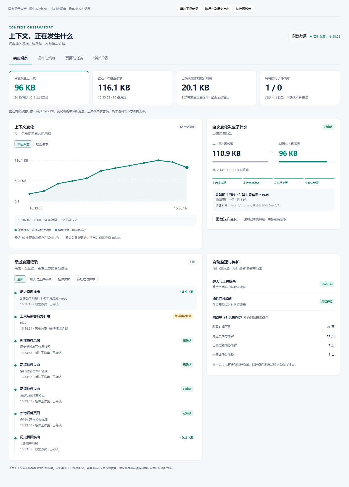
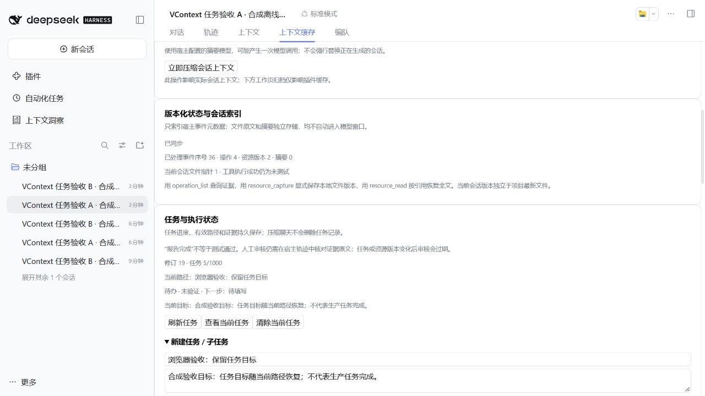
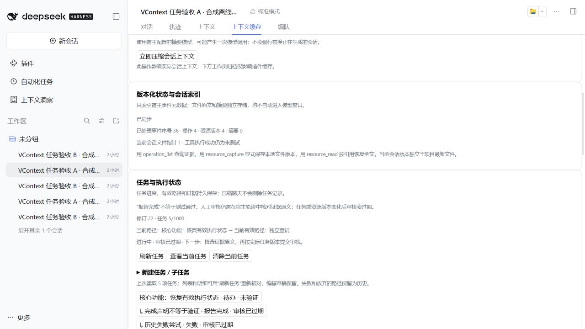
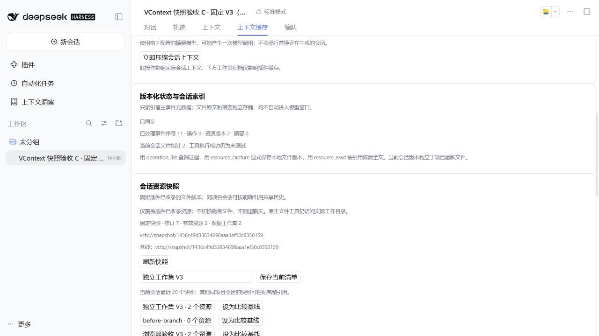
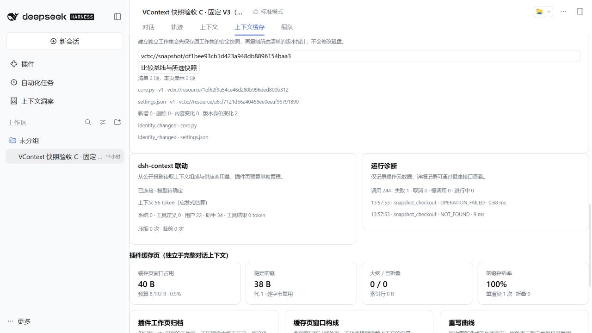
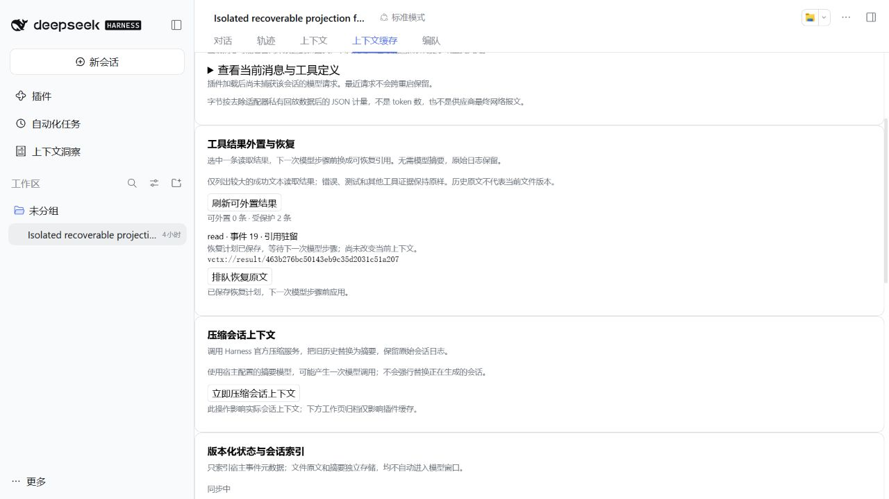
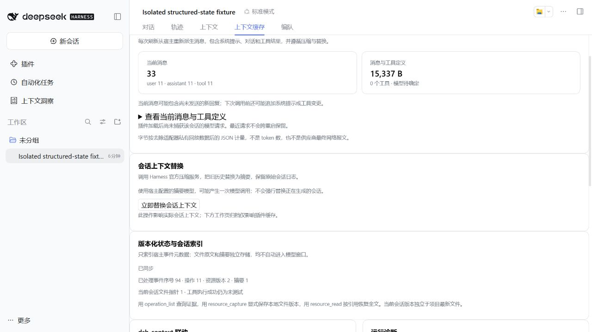
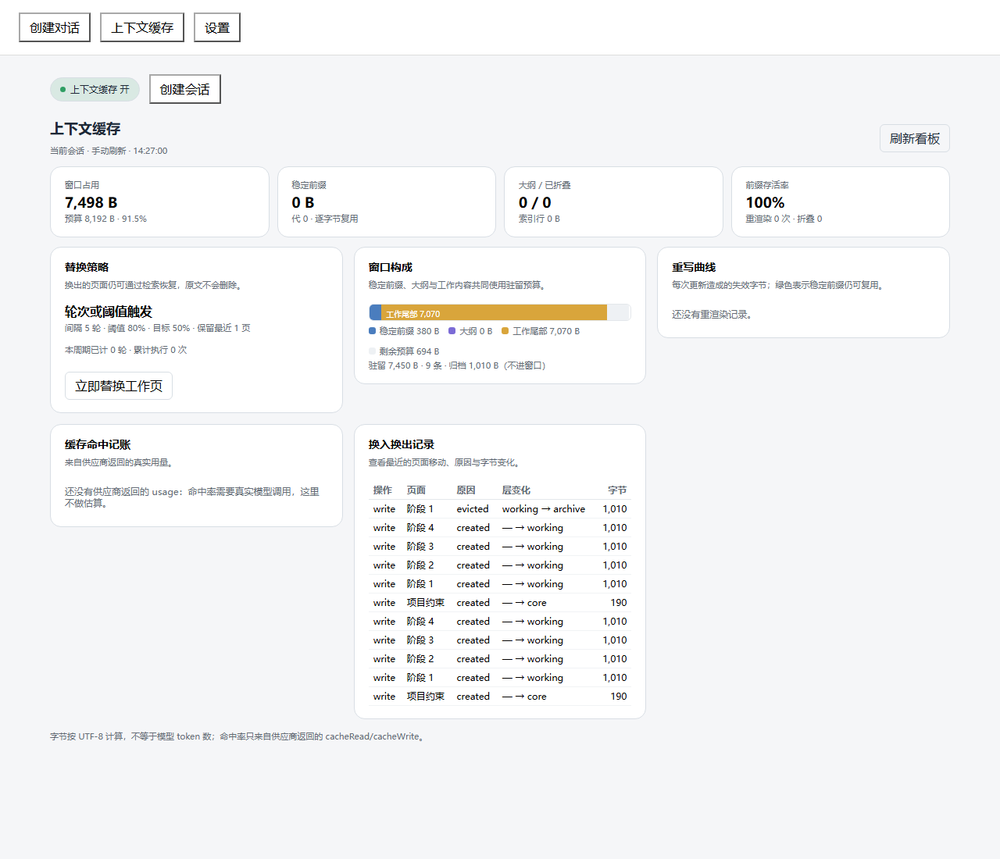
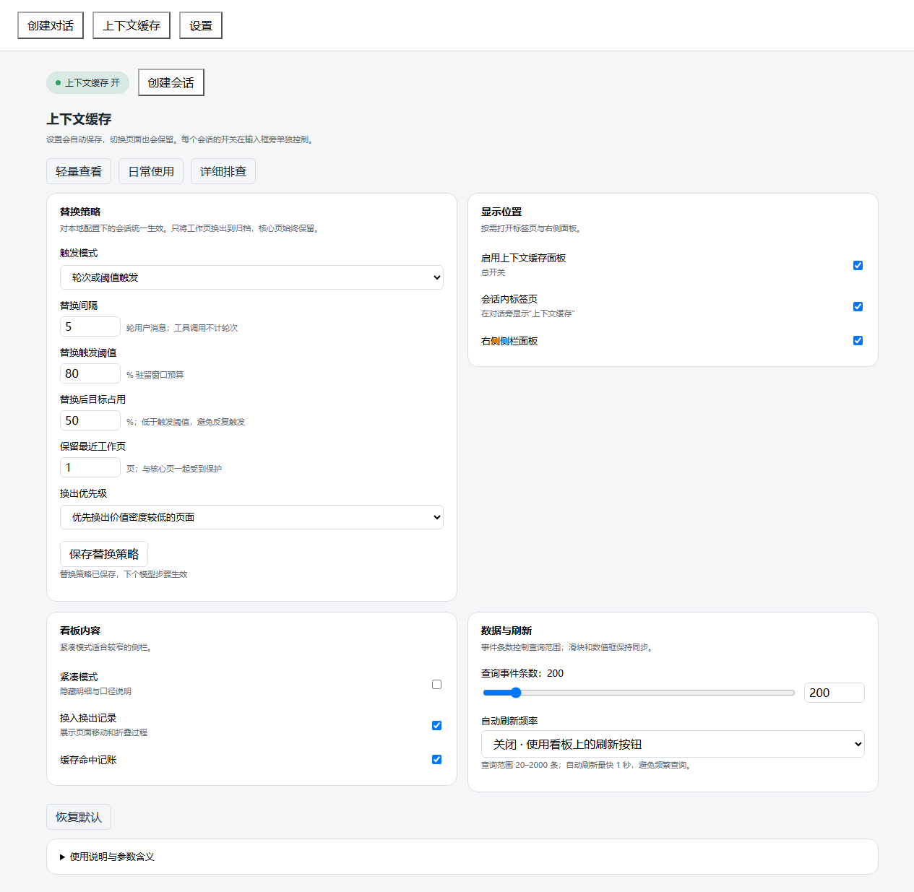

# dsh-vcontext

当前版本：**[v0.14.0](https://github.com/shaocuirong/dsh-vcontext/releases/tag/v0.14.0)** · [可视看板](docs/guides/UI.md) · [0.14.0 节点](docs/releases/nodes/NODES-0.14.0.md) · [自动整理设计](docs/architecture/AUTOMATION-0.13.0.md) · [更新日志](CHANGELOG.md) · [验证记录](docs/releases/VALIDATION.md)

**DeepSeek Harness 客户端虚拟上下文管理器**：结构化操作、可追溯资源版本、有来源的摘要、按需换页与会话内看板。

[](https://github.com/shaocuirong/dsh-vcontext/actions/workflows/test.yml)
[](LICENSE)

默认页面存储、旧会话归档和工具结果外置离线运行，不需要额外的模型 API Key。“压缩会话上下文”则使用 Harness 配置的摘要模型，可能产生模型调用。适用于本地、单用户 Harness 环境。

> 仓库名为 `dsh-vcontext`；安装包名和插件标识保留 `dsh-virtual-context`，兼容既有配置。界面统一显示“上下文缓存”。

## 功能

- **结构化会话索引**：通过公开 SessionQuery 接口增量同步 Native / PTC 操作元数据、来源 seq 和状态；幂等连续游标、Fork 与 Surface 投影区分，工具成功仍为未测试。
- **版本化资源与摘要**：不可变 SHA256 内容对象、每会话当前路径指针、CAS 更新和 request_id 去重；历史原文按引用读取，摘要保留来源而不覆盖证据。
- **会话资源快照**：一次事务冻结全部已收录资源的清单，支持固定历史清单、返回保留工作集、从快照建立独立可写工作集及分页差异。覆盖前自动保存安全快照；固定期间拒绝插件资源写入，不回滚磁盘文件或聊天，不自动继承 DSH Fork 切点。
- **任务与执行状态**：持久任务树、进度版本、下一步与当前路径；工具调用按当时焦点关联，迟到结果不归给新任务。失败路径保留，可建立新的尝试；模型报告完成仍为未验证，人工审核绑定证据及任务/资源/活动水位，变化后失效。压缩后通过宿主请求重新注入有界任务状态。
- **可选文件捕获**：默认关闭；宿主显式启用后，经宿主 fs 有界读取项目内 UTF-8 文件，返回版本引用。不会自动扫描仓库、覆盖文件或创建 Git 提交。
- **工具结果外置与恢复**：明确选择较大的成功文本读取结果，保存完整数据和计划，在下一次真实模型步骤前将原位置换为引用；支持分页读取与排队原位恢复，不生成摘要，不改原始历史。等待状态明确显示，错误、测试、执行和多模态结果默认保护。
- **会话历史归档**：通过宿主 Surface 将完整旧轮次的聊天和工具结果换成短引用；下一次模型请求不再携带原文，宿主原始日志保留。最近两轮及宿主指令受保护；含工具结果投影等替换节点的轮次整体保留，无法确定归属时拒绝归档。可用 `vctx history_read` 按引用读取旧证据，不调用摘要模型。
- **可发现与可管理的归档**：归档支持 request_id 幂等与预览 CAS；模型上下文注入有界 `vctx_history` 大纲（≤2 KiB、最多 8 条），可用 `history_list` 列举、`history_search` 有界词法检索、`history_read(seq)` 按单条原始消息读取；看板显示归档清单并支持搜索。清单、检索与重放只认本会话引用，Fork 子会话不继承父会话的归档登记。不新增数据库表，不改变宿主日志权威。
- **细粒度历史分页与手动换出**：在已结束 turn 内按 step / tool-call group 建页；history_pages 只读预览分页与 quota_trial，宿主空闲时通过 `POST /vctx/history/page-out` 单页换出并生成 vctx://history 引用，history_page_list 列出 marker 派生页面注册表。默认保护最近两页，只接受 sealed、tool_balanced、非 opaque 页；不写 SQLite vh_*，不做 page-in 或多消息原位恢复。
- **可配置在线配额（L2）**：SQLite `vq_*` 账本记录在线逻辑单元、会话/项目上限、预留与引用计数；页面准入与释放保持事务一致。`/vctx/quota` 与看板提供容量、水位设置。估算器按 UTF-8 字节 / 3，不是供应商 token；project 仍固定 default，资源/摘要未自动接入。
- **默认开启两层自动整理**：L1 在宿主空闲维护时，把合法完整旧页换成可恢复引用；L2 在步骤、准入与容量变更时按 85%/70% 高低水位整理。保护未完成任务依赖、core/pin、最近 6 页/8192 估算 tokens、至少 2 步驻留及冷恢复；保留原始历史。看板可分别关闭两层，显示候选原因、访问记录与持久回执。缺少新鲜上下文压力时 L1 暂停，运行中的 turn 不换出。
- **压缩会话上下文**：通过 Harness 官方压缩服务将旧历史替换为摘要，保留原始日志；原“会话上下文替换”按钮更名，行为及已有 API 保持兼容。
- **dsh-context 联动**：可选读取公开会话投影，展示上下文组成、压缩次数和供应商累计用量；优先使用宿主 token-meter，无数据时明确显示估算或未连接状态。
- **运行诊断**：有界结构化日志、请求编号、耗时、错误分类、慢调用与健康检查；不记录正文或原始错误内容。
- **内核恢复**：回滚时清除未提交缓存、复用页面序列化、限制 RPC 缓冲和排队数量，异常服务可重新启动；存储不可用时保留上次快照并允许宿主继续生成。
- **实时上下文**：读取活跃会话或只读还原磁盘上的已有多轮会话，无需新发消息；展示插件加载后最近一次 LLM 调用的独立快照，默认每 2 秒刷新。
- **专用看板**：主看板隐藏输入框，回到聊天自动恢复；右侧面板不影响聊天输入。
- **分层记忆**：`core` 核心页常驻；`working` 工作页按需换出；`archive` 归档页可检索恢复。
- **四种工作页归档模式**：手动、每 N 轮、达到占用阈值、轮次或阈值任一满足。
- **可调参数**：间隔、触发阈值、目标占用、保留最近页数，以及低价值密度 / 最久未使用优先。
- **会话内界面**：输入框旁开关、同名导航标签页、右侧面板、分组设置与卡片式看板。
- **持久恢复**：SQLite 事务、不可变修订、会话隔离、检查点恢复；换出不删除原文。
- **前缀与用量**：稳定核心前缀、快照失效记录、供应商实际返回的缓存读写记账。
- **交互反馈**：创建会话前预选、错误重试、请求超时、手动与周期刷新。

## 界面预览

### v0.14 实时上下文观察台

首页直接显示派生上下文与模型请求趋势、真实替换前后差值、聊天/工具来源和恢复引用。变更记录可筛选、选中并回放，排队与未确认状态不计入收益；操作、任务和诊断独立分组。



截图来自隔离演示会话，使用真实 SDK Surface 与临时数据库；不是用户会话，也没有真实供应商调用。开发者从源码运行 `npm run preview:dashboard` 可交互验证。


以下截图来自独立预览，使用演示数据。它们不代表模型效果或真实供应商缓存收益。

<details open>
<summary>0.8.0 原生任务状态：目标、有效路径与可追溯进度</summary>



0.8.1 修复任务修订不变时的审核过期刷新；列表和明细明确标记为上次手动读取。



</details>

<details open>
<summary>0.7.0 原生会话资源快照：固定目标与独立工作集</summary>





</details>

<details open>
<summary>0.6.0 原生可恢复投影：排队状态与摘要压缩分开</summary>



</details>

<details open>
<summary>0.5.0 原生 Harness 结构化状态验收</summary>



</details>

<details open>
<summary>卡片式上下文缓存看板</summary>



</details>

<details>
<summary>工作页归档设置（旧版截图）</summary>



</details>

## 安装到 Harness 桌面端

要求：DeepSeek Harness、Python 3.10+、Node.js 22+。基础 SDK 回归基于 `0.2.0-rc.2`，工具结果投影和会话压缩已在本机 Harness `0.2.1-rc.2` 验证；历史归档使用公开维护、会话与持久化接口及原生 Surface 替换，压缩需要 `compactNow`。缺少能力时显示原因，原始历史保留。

**数据库升级注意**：从0.9.0升至0.10.0无数据库迁移，无Python内核改动；旧版本升级至主schema9仍须先完全退出所有使用同一数据库的宿主，再更新并重启（包括托盘）。主schema1–8先生成唯一 `.pre-schema9-<id>.bak` 再事务迁移至schema9/vc2/vcr1/vcs1/vct1。旧0.7拒绝新库，禁止混跑版本。插件不覆盖数据库、备份或profile。

先完全退出桌面端，包括系统托盘，再安装：

```powershell
git clone https://github.com/shaocuirong/dsh-vcontext.git
cd dsh-vcontext

dsh plugin --profile desktop add "link:$((Get-Location).Path)"
```

如果 `dsh` 不在 PATH，请使用桌面端安装目录中的 `resources/runtime/cli/bin/dsh.cmd` 调用相同参数。

**安装依赖后还需要启用 bundle。** 确认 `~/.dsh/profiles/desktop/package.json` 的 `dsh.profile.bundles` 数组包含：

```json
"dsh-virtual-context"
```

只追加这一项，保留现有 bundle；JSON 文件应保存为 UTF-8 无 BOM。然后重新打开 Harness。`link:` 安装后不要移动仓库目录，否则需重新安装链接。

默认数据库为 `~/.dsh/dsh-vcontext/context.db`；设置了 `DSH_HOME` 时相对于该目录。插件优先使用 Harness 已下载的 Python 运行时，其次使用系统 Python，也可在本地 profile patch 中覆盖 `python` 和 `dbPath`。详见 [使用说明](docs/guides/USAGE.zh-CN.md)。

0.5.0 首次打开旧库会先生成同目录唯一 `.pre-schema7-<id>.bak`，再事务迁移；已有页面、配置、检查点和用量保留。主 schema 升为 7，旧插件不能直接读取升级后的库，回退需先退出宿主并人工选择备份。不要用旧数据库文件覆盖新数据。

0.6.0 保持主 schema7 / vc2，增量增加结果表 vcr1。首次打开已有 schema7 库前生成唯一 `.pre-result1-<id>.bak`。降级前先取消排队计划并恢复仍驻留的引用，确认已应用，再退出宿主切换代码；旧插件没有 result_read。备份不是自动覆盖恢复指令。

## 快速使用

1. 点击输入框旁的“上下文缓存”，开启当前会话的面板；也可以输入 `/virtual-context on`。
2. 打开会话导航或右侧栏的“上下文缓存”。
3. 让 Agent 保存内容，例如：

   > 调用 vctx，operation=write，input={"title":"项目约束","content":"离线优先；数据库采用 SQLite。","tier":"core"}。

4. 换题时使用 `recall` 检索已归档内容；需要原文时使用 `read`。
5. 在“工具结果外置与恢复”刷新候选，逐条选择外置或恢复；在设置中另行保存工作页归档策略。显示偏好会自动保存。
6. 要让旧聊天和工具结果退出下一次模型请求，点击“归档旧聊天与工具结果”，再用 `vctx history_list` 查看归档清单、`history_search` 在归档原文中检索、`history_read`（可带 `seq`）按引用或单条消息取回需要的证据；看板归档按钮会自动生成 `request_id` 并携带预览的 `expected_surface_seq`；预览未变时重试复用同一身份，成功后或预览刷新后换新。提交结果不确定时先刷新再重试同一身份，不要仅因响应丢失就换新 ID。需要摘要时另用“立即压缩会话上下文”。“仅归档插件工作页”和自动策略只管理 vctx 工作页。生成中的会话需等待结束。
7. 用 `operation_list` 查询宿主操作索引；用 `resource_store` 保存明确文本，或启用后用 `resource_capture` 捕获文件版本；从返回值保留 ref，再通过 `resource_read` 按需读回旧版本。详见 [结构化状态 API](docs/guides/API.md#结构化状态与资源050)。

8. 在“会话资源快照”保存清单，再选择固定、返回或建立独立工作集。固定时插件按路径只读所选版本，完整范围及冲突恢复见 [使用说明](docs/guides/USAGE.zh-CN.md#会话资源快照070)。

9. 在“任务与执行状态”建立任务/子任务、设为当前任务并保存进度和下一步。任务状态、版本与来源在宿主重启后保留；人工审核需先在轨迹中核对已关联证据。

v0.10.0 在无摘要 Surface 归档之上补齐可重试、可列举、可检索与按消息读回；v0.9.0 提供归档本体，v0.8.0 任务树、v0.7.0资源快照、v0.6.0工具结果投影继续独立保留。多消息原位恢复、自动归档策略、语义检索、整个工作区快照、Git DAG、自动Fork继承、完整MAGE策略、事实图、自动增量/层级摘要、MCP服务器和统一双命中率调度仍是后续阶段。版本号不代表原方案同号里程碑的全部验收；论文引用不代表完整算法复现或跑分证明。

工具的 `input` 字段实际接受 JSON 字符串：

```json
{"operation":"recall","input":"{\"query\":\"项目约束\",\"limit\":3}"}
```

## 插件工作页归档模式

| 模式 | 触发方式 |
| --- | --- |
| 手动（默认） | 看板点击“仅归档插件工作页” |
| 每 N 轮 | 收到 N 条新的真实用户输入后触发 |
| 达到阈值 | 模型步骤开始前，占用达到配置的预算百分比 |
| 轮次或阈值 | 两者任一满足即执行 |

可以设置每 1–100 轮、10%–100% 触发阈值、5%–95% 目标占用、保护最近 0–20 页。目标占用必须低于触发阈值。轮次按用户消息来源去重，内部环境注入、工具通知和同轮工具调用不计入。

归档只将可换出的工作页移出驻留集合，保留原文。核心页与最近受保护工作页不会被强制移走；若因此达不到目标，看板会说明原因。设置对同 namespace 的会话统一生效，在模型步骤或新消息到来时检查，没有后台清理定时器。

## 开发与验证

```sh
npm ci --ignore-scripts
npm run doctor
npm run check:release
python -m unittest discover -s tests -v
npm test
python -m examples.demo
npm run bench
```

`VCTX_PYTHON` 可指定测试使用的 Python；`VCTX_SDK_ROOT` 可指定独立 SDK 安装目录。官方 SDK 测试缺少依赖时会明确跳过，不应把跳过当成验证成功。仓库 CI 在 Windows / Ubuntu 上运行 Python 和 Node 测试。

0.3.0 在本机通过 41 项 Node/SDK 测试和 63 项 Python 测试；包含真实 `dsh-context@0.74.0` 注册、上下文替换与卸载验证。另使用本机 Harness `0.2.1-rc.2` 的隔离 profile 检查设置、开关及演示会话投影；本轮未进行供应商模型生成测试。详见 [优化与可用性审查](docs/releases/OPTIMIZATION-0.3.0.md)。

0.3.1 修复已有会话开启面板后读不到历史上下文的问题：本机 47 项 Node、63 项 Python 测试通过；真实 Harness JSONL 三轮会话在开启面板后、宿主重启后均能直接读取，读取前后日志 SHA256 一致。历史读取不会自动创建 Agent、写入缓存页或构造“最近模型请求”。

0.10.0 在本机通过 179 项 Node/真实 SDK 和 176 项 Python 测试，0 失败、0 跳过；`npm run check:release` 输出 v0.10.0，`npm run doctor` 退出 0。未进行桌面端重启后的真人浏览器点击验收；看板的归档清单、搜索与 CHANGED 重试状态机由单元/路由/组件测试覆盖，仍不是真实浏览器点击验收；看板归档按钮自动生成并复用 `request_id`，携带预览的 `expected_surface_seq`，遇 CHANGED 会先刷新预览再换新身份，重放成功标注为原回执。已知限制见 [验证记录](docs/releases/VALIDATION.md)。

0.10.3 修复历史读取边界：整段与单条 `history_read` 都受字符/UTF-8 响应上限约束，大消息分页返回，小消息保持原对象形状；`expected_content_hash` 用于续读校验。文档目录重排为 guides / architecture / research / releases / planning / images。本机 191 项 Node/真实 SDK、176 项 Python 测试通过；未进行桌面重启后的真人浏览器点击验收。详见 [验证记录](docs/releases/VALIDATION.md)。

## 可选启用 dsh-context 联动

完全退出 Harness 后，在同一 profile 安装：

```powershell
dsh plugin --profile desktop add dsh-context@0.74.0
```

在该 profile 的 `dsh.profile.bundles` 中保留原有项目，并确保同时包含 `dsh-context` 和 `dsh-virtual-context`，然后重启。联动通过宿主 `sessionProjections.snapshot()` 读取公开数据，不导入上游内部实现，不共享数据库，也不会代替宿主压缩历史。未安装上游插件仍可使用全部缓存功能。

若要关闭联动，可在既有本地插件配置中追加 `contextIntegration: false`。上游接口与本插件预算的口径见 [API 与诊断配置](docs/guides/API.md)。

已进行独立浏览器交互检查，以及授权历史消息的本地回放：552 页原文完整性、归档检索、轮次去重、阈值触发、核心页保护和预算上限均通过。只发布汇总结果，不包含真实对话或数据库。见 [验证记录](docs/releases/VALIDATION.md)。

## 边界

- 页面预算默认按 UTF-8 字节计算，**不是模型完整上下文窗口**。旧会话归档和宿主压缩会改变模型可见 Surface，但不会删除宿主原始历史。
- 归档检索是大小写不敏感的离线词法子串检索，只扫描最近 8 个归档、最多 2048 个源事件 / 4 MiB 文本，返回有界摘录而非正文；其中最近 8 个归档的上限有单元测试覆盖，2048 事件 / 4 MiB 上限为代码检查、未做大规模压力测试。归档引用是历史证据指针，不代表事实仍有效或文件版本仍相同。
- 面板开关控制显示，不会自动归档聊天记录，也不会暂停已启用的工作页归档策略或明确提交的投影计划。内容由 Agent 通过 `vctx` 显式保存。
- 字节稳定不保证供应商缓存命中；命中率仅来自实际 usage，没有记录时显示空状态。
- 默认检索是离线词法基线，不代表神经语义检索。可选 sentence-transformers 模型需自行安装，见 [研究映射](docs/research/RESEARCH.md)。
- 数据库为本机明文文件。会话隔离是应用层隔离，不是多租户认证机制。

## 文档

- [文档索引](docs/README.md)
- [中文使用说明与参数](docs/guides/USAGE.zh-CN.md)
- [API](docs/guides/API.md) · [界面实现](docs/guides/UI.md) · [缓存层设计](docs/architecture/CACHE.md)
- [验证记录](docs/releases/VALIDATION.md) · [研究映射](docs/research/RESEARCH.md)
- [参与贡献](CONTRIBUTING.md)

## License

[MIT](LICENSE)。Harness SDK 与可选模型各遵循自身许可。
