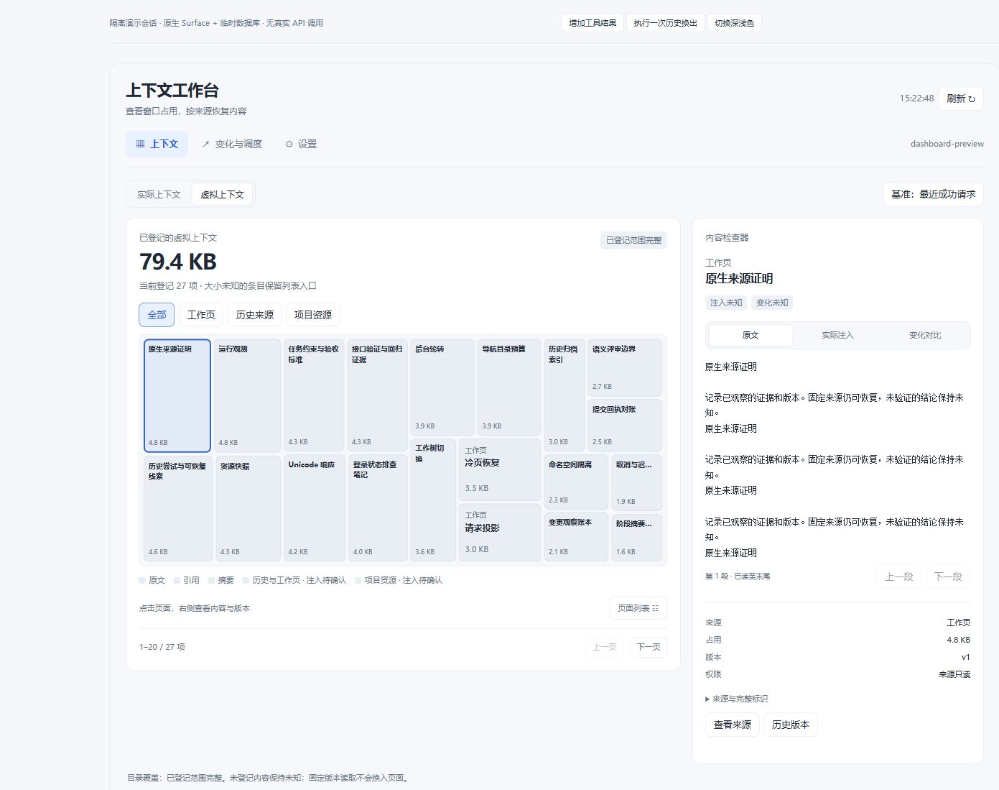

# dsh-vcontext

**DeepSeek Harness 的虚拟上下文管理插件。** 保留可恢复原文，维护来源、版本和活动状态，按预算选择原文、引用或摘要，并通过圆角空间画布查看上下文。

当前版本：**[v0.18.1](https://github.com/shaocuirong/dsh-vcontext/releases/tag/v0.18.1)** · [安装与升级](docs/INSTALL.md) · [使用说明](docs/guides/USAGE.zh-CN.md) · [API](docs/guides/API.md) · [更新日志](CHANGELOG.md)



## 这一版包含什么

- **上下文工作台**：跟随宿主深浅色、紧凑顶部导航、页级矩形图与可读列表、右侧内容检查器；窄容器中使用模态抽屉。
- **实际与虚拟上下文**：实际请求和已登记来源分别查看，支持固定版本原文、摘要、历史版本、新收入及内容变更标签。
- **会话访问层**：统一活跃与冷会话读取、观察租约、取消与宿主写入口，读取不会隐式激活历史 Agent。
- **上下文控制层**：统一目录、来源版本、依赖失效、保护依据、调度仲裁与提交对账；保留原文和恢复入口。
- **有界恢复与准入**：固定引用解析、分页读取、每步恢复额度和可用计量下的发送前容量检查。
- **显式阶段摘要**：来源证明、候选、独立语义评审和版本校验后的激活；摘要不代表测试通过。
- **独立参数设置**：聊天工作预算、在线容量、水位、目录开关与自适应策略；展示偏好在当前浏览器保存。

历史归档、页面存储与工具结果外置可离线运行；宿主会话摘要会使用 Harness 配置的模型。插件不承诺供应商费用、缓存命中率或回答质量的固定收益。

## 安装

要求 Node.js 22+、Python 3.10+ 和支持公开会话/维护接口的 DeepSeek Harness。基础 SDK 回归使用 `0.2.0-rc.2`；桌面可用性还取决于宿主版本。

推荐从 [Release](https://github.com/shaocuirong/dsh-vcontext/releases/tag/v0.18.1) 下载安装包；也可使用固定版本源码：

```powershell
git clone --branch v0.18.1 https://github.com/shaocuirong/dsh-vcontext.git
cd dsh-vcontext
dsh plugin --profile desktop add "link:$((Get-Location).Path)"
```

在该 profile 的 `dsh.profile.bundles` 中启用 `dsh-virtual-context`，保留其他配置。升级前完整退出 Harness（包括托盘），备份数据库和本机 profile，再更新插件并重启。详见 [安装与升级](docs/INSTALL.md)。

默认数据库位于 `~/.dsh/dsh-vcontext/context.db`；设置 `DSH_HOME` 后相对于该目录。安装包名与插件标识仍为 `dsh-virtual-context`。

## 使用

在输入框旁打开“上下文”，然后选择工作台的三个入口：

| 入口 | 用途 |
|---|---|
| 上下文 | 实际/虚拟空间、分类展开、页面内容、来源与版本 |
| 变化与调度 | 操作回执、历史归档、工具结果恢复、来源笔记、活动任务与资源快照 |
| 设置 | 调度、预算、容量、水位、工作页策略与展示偏好 |

点击方块查看内容，不会自动把原文换入模型请求。颜色表示已观察的表示方式，变化标签与颜色独立；没有证据的状态显示未知。

## 开发

```sh
npm ci --ignore-scripts
npm run build:client
npm run check:client
npm run check:release
npm run doctor
npm test
python -m unittest discover -s tests -v
npm run preview:dashboard
```

前端源码位于 `client/`，构建产物为 `lib/client.js`；React 使用宿主实例。隔离预览使用真实 SDK Surface、合成内容与临时 SQLite，没有供应商调用。截图和本地测试不等于正式宿主或真实供应商验收。

## 范围与兼容性

- 单用户本地插件；目录只覆盖已登记来源及有界扫描范围，不自动索引整个工作区。
- 宿主估算 tokens、请求 JSON 字节、来源字节与供应商用量分别计量。
- 固定来源仍可恢复；来源过期影响当前适用性，不删除历史原文。
- 数据库包含增量扩展与版本校验，不能用旧内核直接操作已升级数据库；回退应使用完整备份。
- **0.18.0 移除旧 Python HTML 报表、`vcontext-dashboard` 命令、旧版方案/节点文档及过期截图。** 使用新的工作台和 `npm run preview:dashboard`；核心 `dashboard` 数据操作保留。
- 真实请求页与持久历史页尚无完整映射；缺少旧正文时只显示版本变化，不生成虚构的文本差异。

## 文档

[架构](docs/ARCHITECTURE.md) · [界面](docs/guides/UI.md) · [当前验证记录](docs/VALIDATION.md) · [文档索引](docs/README.md) · [贡献说明](CONTRIBUTING.md)

维护契约保存在 [Session Access skill](skills/dsh-session-access/SKILL.md) 与 [上下文控制 skill](skills/dsh-context-control/SKILL.md)。旧版本记录可从 [GitHub Releases](https://github.com/shaocuirong/dsh-vcontext/releases) 或对应 Git 标签查看。

MIT License，见 [LICENSE](LICENSE)。
