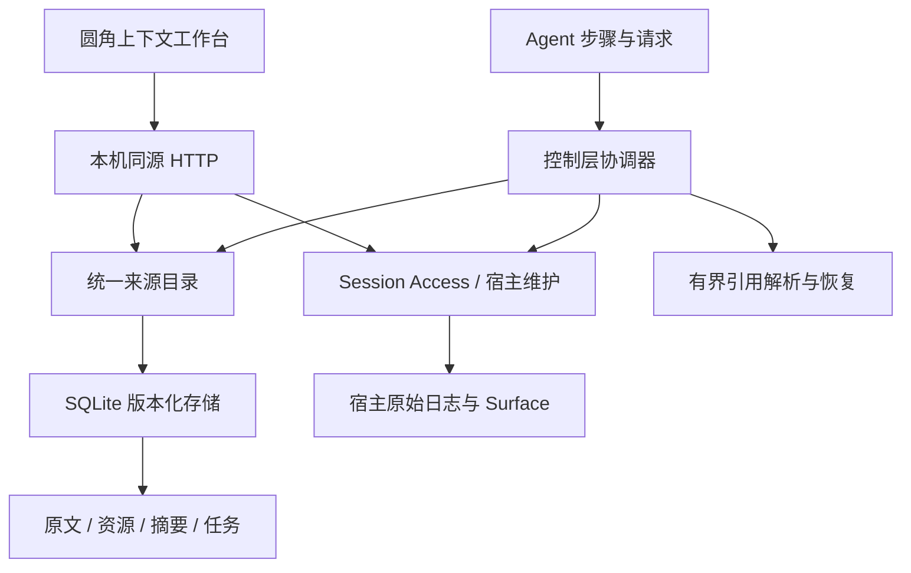
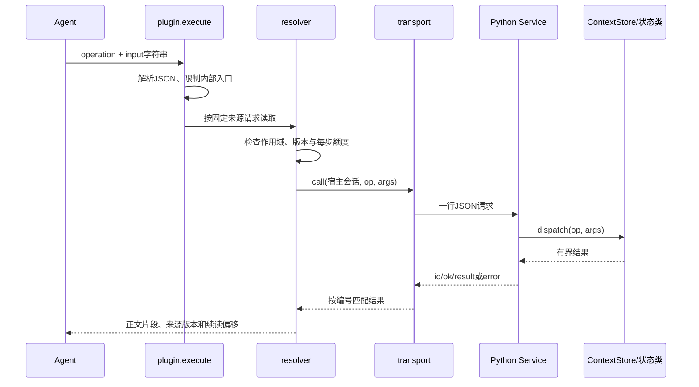

# 架构、职责与调用链

第一次阅读请先看 [从零理解设计](DESIGN.md)。本页解释模块怎样连接，具体文件、类、内部方法与回调全部收录在 [源码参考](reference/README.md)。

## 数据与权限

| 内容 | 表示与更新 | 权限 |
|---|---|---|
| 宿主契约 | 系统指令、协议和工具定义原样保留，只计量 | 宿主拥有 |
| 活动状态 | 当前目标、路径、进度与下一步，可显式更新 | 版本化操作 |
| 派生受保护投影 | 当前索引、阶段摘要可重算，带依据版本及失效条件 | 程序管理、模型提议 |
| 可调度来源 | 原文、固定引用或有来源的摘要 | 准入与依赖校验 |

来源目录共用 page/resource 两类身份；工具结果属于页成员。摘要是来源的派生表示，原始证据不被覆盖。固定历史的可恢复性与当前适用性分开：stale 影响使用资格，不删除原文。

## 会话与提交

`adapter/session/` 统一活跃和冷会话观察、项目身份、取消、租约和写入口。冷读取不激活 Agent、不发模型请求。宿主表面水位与 SQLite 已确认游标独立维护，迟到或取消响应不能推进游标。

`adapter/control/` 负责统一保护候选、目录投影、版本与失效、动作仲裁、提交对账、恢复额度与请求准入。封口历史页在宿主空闲维护中替换；完整读取结果在合法步骤边界外置。宿主日志与 SQLite 属于不同提交域，丢失确认时先对账，不能把写租约当作宿主幂等保证。

## 版本与恢复

资源固定引用、内容哈希和插件 ledger 版本标识具体内容；Git 描述符还区分提交和未提交工作树。外部/生成内容可仅有快照。工具触碰路径、来源版本与依赖水位提供失效依据；仅有路径、dirty 布尔值或模型叙述不足以证明内容有效。

定位缓存只加速已知引用解析，按会话、工作树与服务代次隔离。读取和来源展开受单次/每步额度约束，响应按完整 JSON 的字节与码点分页。读取固定版本不自动换入页面，恢复需要单独通过容量准入。

阶段摘要通过准备依据、不可变候选、独立语义评审和 CAS 激活进入当前投影。原生历史/native/PTC 来源需要宿主证明；来源、任务或写依据过期会撤销当前投影。语义评审不提升为测试或人工验证。

## 客户端

`client/` 是新客户端源码；`lib/client.js` 为构建产物。`dashboard.js` 组合三个主入口，`workbench.js` 管理状态，`canvas-view.js` 渲染单一画布和同级检查器，`runtime.js` 管理请求与提交生命周期。圆角切块按同口径计量，无法映射或覆盖不完整的内容保留未知。

完整维护边界见 [Session Access](../skills/dsh-session-access/SKILL.md) 与 [上下文控制](../skills/dsh-context-control/SKILL.md)。具体接口见 [API](guides/API.md)。

## 装配入口与依赖方向

| 入口 | 主要方法 | 为什么放在这里 |
|---|---|---|
| `index.mjs` | `apply` | 只负责创建各服务、接线和登记卸载清理 |
| `adapter/plugin.mjs` | `mount`、`attach`、`refresh`、`execute` | 宿主工具、变量和 Agent 生命周期的交界处 |
| `adapter/routes.mjs` | `createHandler`、`mountRoutes` | 把浏览器请求转给业务服务，同时校验来源与输入 |
| `adapter/session/access.mjs` | `withRead`、`withLiveCut`、`withWrite` | 各业务模块共享一种访问、取消和租约规则 |
| `adapter/control/coordinator.mjs` | `exclusive`、`execute`、`reconcile`、`local` | 同会话动作排队、计划版本检查与提交对账 |
| `adapter/transport.mjs` | `createTransport`、`call` | 隔离上层与 Python 的启动/通信细节 |
| `vcontext/server.py` | `Service.handle`、`store`、`serve` | 校验进程请求、管理作用域连接并逐行回复 |
| `vcontext/core.py` | `ContextStore.dispatch` | 事务内组合页、资源、任务、配额等状态类 |

每行的方法签名、参数、返回和异常可从 [方法总索引](reference/SYMBOLS.md) 找到。目录地图中也包含测试、配置、文档、维护契约和生成产物。

## 启动与卸载

`apply` 先调用 `resolveConfig` 计算默认值，再通过 `mount` 创建诊断、存储通道、会话访问、控制协调器、历史归档、来源目录、解析器、请求准入和同步桥。外围入口创建结果、任务、快照、自动化及工作台服务。

`attach` 为 Agent 注册 `vctx_pages`、`vctx_session_target`、`vctx_task_state`、`vctx_history`、`vctx_evidence`。`refresh` 获取有界投影后更新变量。页面正文始终是不可信数据；正文里的花括号不能再触发宿主变量查找。

各模块通过宿主 effect 清理器调用 `dispose`，关闭进程、监听、缓存、队列和在途观察。异步等待之后还要检查生命周期；取消和迟到响应不能继续推进确认游标。

## 模型读取的端到端链路

历史与原生事件的权威内容在宿主日志，因此解析器按来源选择宿主入口，不把所有读取强制转到 Python。定位缓存只保存固定定位描述，不缓存租约、正文或不断变化的新鲜度。

## 步骤边界与交付基线

真实 `agent/pre-step` 边界驱动会话同步、策略 tick、控制动作和投影刷新。恢复结果要在合法边界应用，并接受容量准入。精确监听次序以 plugin、result-projection 和 admission 中的 prepend 与注册位置为准，不能把示意图当作所有宿主版本固定事件顺序。

目录 `prepare` 生成文字和版本基线，只有对应主请求成功，`delivered` 才推进已交付基线。准备、发送、成功交付和模型理解是不同概念。

## 历史页各模块分别负责什么

`segmentHistoryPages` 判断哪些事件组成一页；`projectHistoryCandidates` 合并保护依据；`planHistoryPageOut` 试算预算和候选；`historyArchive.pageOut` 在合法宿主维护边界执行。

预览保存 Surface 水位，执行前变化就拒绝旧计划。原始事件继续留在宿主日志；归档标记保存精确来源。`history_read` 恢复原始 JSON 文本，UI 使用独立的阅读投影偏移。

## 状态类怎样组合

`StructuredState → SnapshotState → TaskState` 用继承逐步增加资源视图和任务路径。`StageState` 依赖任务状态和页内核，`ResultStore` 组合分块结果与基础结构化状态。各扩展独立检查 schema 版本。

必须看最终组合入口，不能只看父类方法。例如 SnapshotState 覆盖资源读取，让 path 按当前目标清单解析；ContextStore.dispatch 又会在任务完成边界捕获阶段依据。完整数据关系见 [数据定义](interfaces/DATA.md)。

## 六条一致性规则

1. SQLite 内部修改在短事务或保存点中完成，异常回滚。
2. expected_version / expected_revision 防止旧观察覆盖新状态。
3. 相同 request_id 只能重放相同载荷，不能改参数后重用身份。
4. 宿主提交先记录意图，失败或未知时对账；写租约不提供跨系统原子性。
5. 每个异步边界核对取消、服务身份和代次，失效结果不推进游标。
6. 完成状态、语义评审、人工评估和实际测试分别记录，缺失来源保留 gap。

研究思想与实现差异见 [论文参考](REFERENCES.md)，当前验证证据见 [验证记录](VALIDATION.md)。
