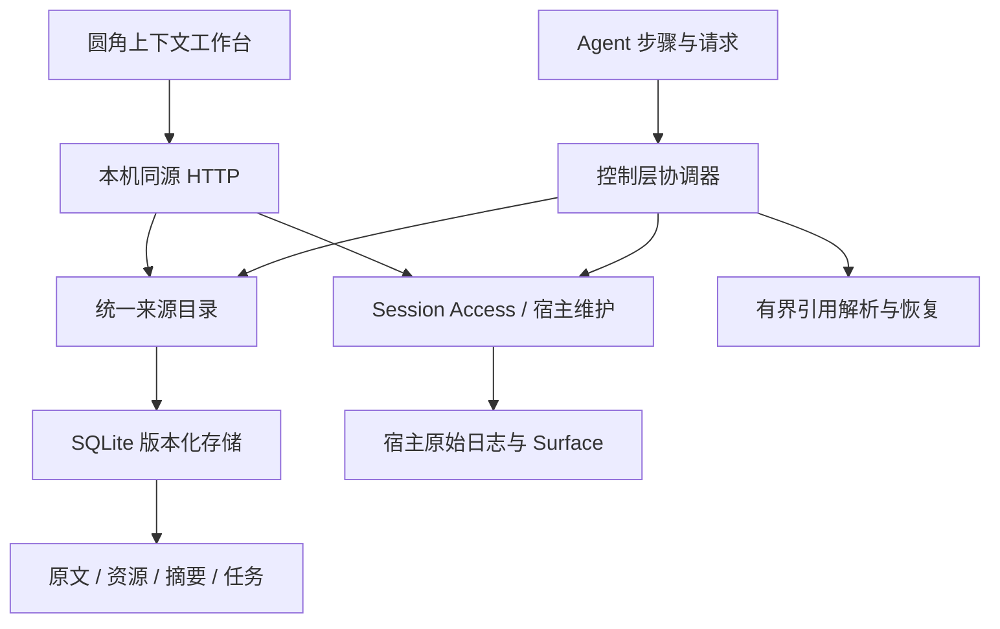

# 当前架构

## 数据与权限

| 内容 | 表示与更新 | 权限 |
|---|---|---|
| 宿主契约 | 系统指令、协议和工具定义原样保留，只计量 | 宿主拥有 |
| 活动状态 | 当前目标、路径、进度与下一步，可显式更新 | 版本化操作 |
| 派生受保护投影 | 当前索引、阶段摘要可重算，带依据版本及失效条件 | 程序管理、模型提议 |
| 可调度来源 | 原文、固定引用或有来源的摘要 | 准入与依赖校验 |

来源目录共用 page/resource 两类身份；工具结果属于页成员。摘要是来源的派生表示，原始证据不被覆盖。固定历史的可恢复性与当前适用性分开：stale 影响使用资格，不删除原文。

## 会话与提交

`adapter/session/` 统一活跃和冷会话观察、项目身份、取消、租约和写入口。冷读取不激活 Agent、不发模型请求。宿主表面水位与 SQLite 已确认游标独立维护，迟到或取消响应不能推进游标。

`adapter/control/` 负责统一保护候选、目录投影、版本与失效、动作仲裁、提交对账、恢复额度与请求准入。封口历史页在宿主空闲维护中替换；完整读取结果在合法步骤边界外置。宿主日志与 SQLite 属于不同提交域，丢失确认时先对账，不能把写租约当作宿主幂等保证。

## 版本与恢复

资源固定引用、内容哈希和插件 ledger 版本标识具体内容；Git 描述符还区分提交和未提交工作树。外部/生成内容可仅有快照。工具触碰路径、来源版本与依赖水位提供失效依据；仅有路径、dirty 布尔值或模型叙述不足以证明内容有效。

定位缓存只加速已知引用解析，按会话、工作树与服务代次隔离。读取和来源展开受单次/每步额度约束，响应按完整 JSON 的字节与码点分页。读取固定版本不自动换入页面，恢复需要单独通过容量准入。

阶段摘要通过准备依据、不可变候选、独立语义评审和 CAS 激活进入当前投影。原生历史/native/PTC 来源需要宿主证明；来源、任务或写依据过期会撤销当前投影。语义评审不提升为测试或人工验证。

## 客户端

`client/` 是新客户端源码；`lib/client.js` 为构建产物。`dashboard.js` 组合三个主入口，`workbench.js` 管理状态，`canvas-view.js` 渲染单一画布和同级检查器，`runtime.js` 管理请求与提交生命周期。圆角切块按同口径计量，无法映射或覆盖不完整的内容保留未知。

完整维护边界见 [Session Access](../skills/dsh-session-access/SKILL.md) 与 [上下文控制](../skills/dsh-context-control/SKILL.md)。具体接口见 [API](guides/API.md)。
