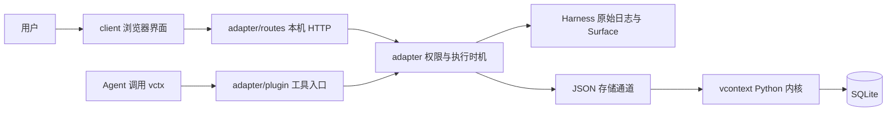
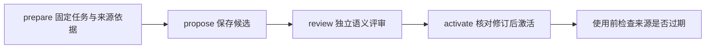

# 从零理解 dsh-vcontext 的设计

这份文档不要求你会 JavaScript、Python 或数据库。读完后，你应该能回答：信息放在哪里，模型这一次能看到什么，什么操作真正省下输入空间，出了问题怎样找回原文。然后再看 [架构与调用链](ARCHITECTURE.md)、[接口](guides/API.md) 和 [逐文件逐方法参考](reference/README.md)。

## 1. 先看一个具体问题

你让 Agent 修改项目。它读了很多文件，执行许多命令。早期报错后来修好了，但旧报错还在聊天里；某次工具输出几万字，眼下只需要一个结论。继续把所有东西带给模型，会占用输入空间，也可能把旧状态与当前状态混在一起。

直接删掉历史也有问题：以后需要精确错误、文件旧版本或当时作出决定的原因，就没有依据了。只留一句摘要同样不稳，因为摘要可能遗漏数字、条件和相互矛盾的观察。

本插件的办法是：**保存原文，把“保存了什么”和“这次送给模型什么”分别管理，再提供有界的找回入口。** 这种把有限窗口与外部存储分开的思路可对照 [MemGPT](REFERENCES.md#r1)。长窗口并不保证模型同样有效地使用每个位置的信息，可对照 [Lost in the Middle](REFERENCES.md#r2)。它们是设计参考，不是本插件效果的实验证明。

## 2. 用书桌和资料柜来理解

| 程序中的词 | 可以怎样理解 | 必须记住的区别 |
|---|---|---|
| 实际上下文 / L1 | 这一次摆到模型面前的书桌 | 要靠宿主实际请求观察判断是否真的离开输入 |
| 在线集合 / L2 | 资料柜里被登记为可调度的资料 | 改变柜里登记状态，不一定改变书桌上的旧聊天 |
| 原始日志 | 按时间保存的原始记录 | 归档和结果外置后仍是原文权威 |
| SQLite | 插件自己的资料账本和存储 | 保存页、资源、任务、来源关系与回执 |
| page / 页 | 可单独管理的内容单元 | 有身份与修订；同标题可以是不同页 |
| resource / 资源 | 某次保存的文件或文本版本 | 保存内容不一定就是磁盘当前内容 |
| ref / 固定引用 | 精确取件号 | 使用实际返回值，不能猜号码 |
| summary / 摘要 | 带来源的简短说明 | 派生内容不能代替原文和验证 |
| projection / 投影 | 把同份证据换一种方式展示 | 原文、引用、摘要不是三个可信等级 |

L1/L2 是本插件的层次名称，不是 CPU 缓存，也不是模型服务器的 KV cache。

## 3. 为什么分成浏览器、适配层和内核

浏览器负责展示和收集选择，不直接打开数据库或启动 Python。JavaScript 适配层使用 Harness 公开服务，知道会话是谁、Agent 是否忙、现在能否维护历史。Python 内核保存数据、校验版本并执行短事务。

这把两类问题分开：宿主层决定“现在有没有权做”，内核决定“数据能否一致地保存”。数据库保存成功不能证明宿主聊天已经替换成功。

## 4. 长工具结果怎样变成引用

1. 宿主产生原始结果事件，带有会话身份、事件序号和工具调用身份。
2. 插件确认结果属于当前会话，且满足替换边界条件。
3. 完整正文先保存为不可变证据，核对来源和哈希；较大正文用分块上传。
4. 创建外置意图。排队只表示“打算做”，实际请求还没改变。
5. 到合法模型步骤边界，再次核对依据，让宿主把正文表示替换为固定引用。
6. 宿主确认后保存回执；恢复正文也需要容量准入。

假如第 5 步成功而第 6 步回执丢失，不能直接重做。先查原日志和账本对账，因为宿主日志和 SQLite 没有共同事务。

对应代码：[result-projection](reference/files/adapter/result-projection.mjs.md)、[coordinator](reference/files/adapter/control/coordinator.mjs.md)、[result_store](reference/files/vcontext/result_store.py.md)。

## 5. 每种动作究竟改变什么

| 动作 | 改变什么 | 保留的边界 |
|---|---|---|
| `write` / `ingest` | 保存插件页及修订 | 归档页保存不清理宿主旧消息 |
| `page_out` | 页离开插件常驻集合 | 不能推导宿主消息已离开下次请求 |
| 历史 page-out | 经宿主维护替换合法封口历史页 | 原始日志仍保留 |
| 结果外置 | 合法工具结果改为引用表示 | 排队不等于已生效 |
| `context_read` | 读取固定来源的一部分原文 | 不自动换入整个来源；返回文本进入普通工具历史 |
| `page_in` / 结果 restore | 显式申请恢复驻留或正文表示 | 仍需保护、配额或请求准入 |
| `snapshot_checkout` | 切换登记资源的读取目标 | 不做 Git checkout，不回滚磁盘或聊天 |
| 宿主 compact | 使用宿主模型摘要能力 | 与离线数据搬移有区别 |

在工作台点开旧文件是在预览保存版本。原生文件工具读到的仍是当前磁盘。判断它们是否一致，要看版本和 freshness，不能只看路径相同。

## 6. 为什么对象需要版本和请求身份

你读到任务修订 7 后，另一个操作已经更新到修订 8。旧表单若直接提交，可能盖掉新进度。`expected_revision` / `expected_version` 就是“只有现在仍是我刚才看到的那版，才执行”。不一致时刷新并重新判断。

`request_id` 解决超时后的不确定性：一次提交没有收到响应，重试必须沿用同一个请求身份和完全相同的载荷。服务可以返回已保存结果；改变载荷必须开始新意图。跨宿主和数据库仍需对账，不能只靠该字段获得原子性。

资源版本研究可对照 [ChronoMem](REFERENCES.md#r8)。本插件只切换登记资源清单，不能让模型忘掉已经见过的后续信息。

## 7. 为什么检索之外还保存任务路径

文字相似不代表当前适用。失败方案的解释可能与当前目标很相似，但不该自动变成当前结论。

任务保存目标、进度、下一步与来源依赖。注入时使用活动路径的有界投影；失败和放弃的路径保留历史。`task_fork` 创建带原任务指针的新同级任务，不恢复文件。

这与 [MAGE](REFERENCES.md#r7) 的执行状态管理相关。本项目没有复现论文的完整环境，也没有用论文成功率充当本项目结果。

## 8. 摘要为什么分四步

准备时先固定具体来源。候选必须保留决定、约束、下一步、未决问题、原文锚点和冲突来源。独立评审检查这些内容；激活前再看任务与来源版本有没有变化。

这避免一句看起来不错的摘要立刻覆盖原始事实。语义评审仍可能出错，不能证明代码测试通过。`not_tested`、任务完成与人工评估分别记录。

增量保存可对照 [ACE](REFERENCES.md#r6)，沿来源补齐证据可对照 [SEEM](REFERENCES.md#r9)，摘要与多粒度检索可对照 [递归摘要研究](REFERENCES.md#r4) 和 [RAPTOR](REFERENCES.md#r5)。

## 9. 容量怎样决定

至少有三种不同的量：插件页序列化字节预算、在线集合估算容量、实际模型输入与窗口观察。它们不能互相替代。

默认页预算 8192 字节；在线集合会话上限 100 万、项目上限 400 万估算 tokens，估算器按 UTF-8 字节除以 3 向上取整。聊天工作预算默认 131072 估算 tokens，有效值还受可用输入容量限制。字段定义见 [配置](interfaces/CONFIGURATION.md)。

超过高水位才开始整理，降到低水位附近停止，减少反复换入换出。开放页、近期页、工具组不完整、活动任务依赖、固定页和刚恢复内容都有保护依据。没有合法候选可以停下并报告原因。

保持前缀稳定只减少本插件不必要的文字重写。[SGLang](REFERENCES.md#r10) 研究的是服务端执行与缓存，本插件没有实现其 RadixAttention。供应商缓存收益仍须真实 usage 证明。

## 10. 一个完整例子

Agent 修复导入失败：先建任务并记录进度，保存 `src/parser.py` 的资源版本。测试输出很长，宿主将合法结果外置。

后来要找准确错误，先用 `context_find` 找候选，再拿返回 ref 调 `context_resolve`、`context_read`，按 `next_offset` 续读。相似错误只是候选，不能冒充精确证据。

完成子任务后准备阶段依据、提交候选并评审。如果文件随后再次被工具修改，依赖版本失效，旧摘要不能继续以当前结论注入。旧摘要与原文仍能解释当时做了什么。

看代码按 `plugin.execute → resolver → transport → server.handle → ContextStore.dispatch → 具体状态类` 走；界面按 `client → routes → 业务控制器 → transport` 走。所有方法见 [总索引](reference/SYMBOLS.md)。

## 11. 怎样判断能力是否已验证

源码和本地测试说明特定输入下的行为；隔离预览检查合成内容的界面；正式宿主重启验收确认安装与挂载；真实供应商实验才能讨论模型质量、token、费用和缓存收益。这些证据不能互相替代。

当前结果见 [验证记录](VALIDATION.md)，论文与实现差异见 [研究参考](REFERENCES.md)。
