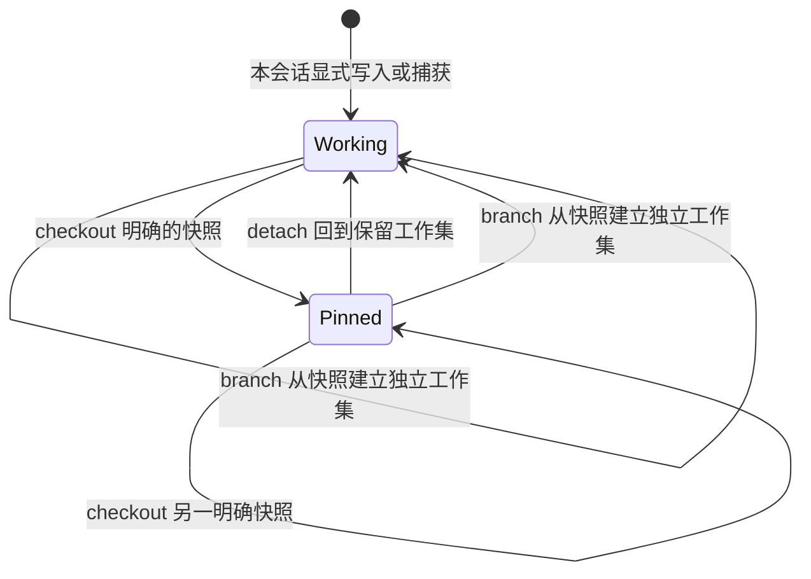

# v0.7.0：会话资源快照与版本隔离

本文细化用户《论文总整理与架构重新设计》中“Project HEAD 与 Session Snapshot 分离”的要求。这里的完整清单覆盖插件已收录的资源，不扫描整个工作目录。本文是实现与验收契约，测试是否通过以本版本 [验证记录](VALIDATION.md)、API 和 CI 实际结果为准。

本版隔离的是 vctx 资源视图。宿主原生 read/write 工具仍访问真实工作目录；固定资源快照不把整个 Agent 的执行环境切回历史 Git 版本。需要历史文件环境的调试仍应使用明确的 Git/worktree 隔离，这部分不由本版快照自动完成。

## 1. 快照到底冻结什么

快照是一份不可变 manifest：按项目内逻辑路径，固定记录这一时点会话目标中的资源引用、内容哈希和版本元数据。它冻结整个已收录集合，而不是只记录某个文件的“最新版本”。空集合也需要明确表示，不能解释为回退到磁盘或项目全局 latest。

`coverage = registered-resources` 是范围声明。某文件没有被显式保存或捕获，就不在快照覆盖范围内；“完整”不能据此推断整个仓库、未跟踪文件、环境配置或所有依赖都已保存。集合事务一致，也不表示各个文件曾在同一物理时刻被同时读取。

内容对象和原资源版本保留原来的身份与来源。manifest 不用摘要代替全文，也不重新执行历史工具。创建快照可以复用不可变内容的索引，原文按需读回时仍需校验哈希；不能宣称创建快照时已重新校验全部磁盘文件。

## 2. 研究依据与工程选择

| 研究 | 本次采用的原则 | 不据此宣称的能力 |
|---|---|---|
| [GCC, arXiv:2508.00031v3](https://arxiv.org/abs/2508.00031v3) | 以明确检查点和独立分支保留可导航的历史状态 | 资源 manifest 不是 Git commit，不提供项目 Git DAG、合并或 GCC 的完整版本文件系统 |
| [ChronoMem, arXiv:2607.27773v2](https://arxiv.org/abs/2607.27773v2) | 选择确定的历史版本集合，恢复语义必须清楚 | 只切换已收录资源解析，没有自然语言版本选择、全局语义回滚或接触未来信息后的反事实正确性保证 |
| [MemGPT, arXiv:2310.08560v2](https://arxiv.org/abs/2310.08560v2) | 可恢复存储与有限实际上下文分开，按需装载内容 | 保存或选择快照不会自动把全部全文注入模型，也不实现完整中断/heartbeat 调度循环 |
| [SEEM, arXiv:2601.06411v2](https://arxiv.org/abs/2601.06411v2) | 通过资源引用、来源和哈希保留可核查证据 | manifest 与关系表不是完整事件帧图推理或 Reverse Provenance Expansion |

这是一组工程映射。CAS 修订、事务、备份、清单分页和分支复制协议由本项目定义，没有论文级正确率或性能保证。全部16篇论文与 DiffMem 见 [RESEARCH.md](RESEARCH.md)。

## 3. 权威边界

| 数据 | 权威来源 | 快照操作的影响 |
|---|---|---|
| 项目当前文件 | 工作目录 / 项目自己的 Git | 不读写或 checkout，不承诺与快照内容相同 |
| DSH 原始对话、工具事件和 Fork 边界 | 宿主 Session Log | 不删改，不恢复旧对话或执行轨迹 |
| 模型可见消息 | 宿主 Surface 与实际请求 | 仅选择资源快照不会移除旧工具结果或其他已见内容 |
| 已收录资源原文 | 不可变内容对象与资源版本 | 固定引用仍指向同一原文，按需校验读取 |
| 资源集合及会话目标 | SQLite 快照 manifest 与 target | 原子切换插件后续资源解析所依据的集合 |
| 任务状态与验证结论 | 对应操作和验证证据 | 不因恢复快照而提升 verification 或把失败路径变为有效路径 |

`Project HEAD != Session Snapshot` 是边界，而不是本版声称读取了 Git HEAD。本版不建立项目 HEAD 的新数据库镜像，工作模式也只随本会话明确的资源写入变化，不自动跟随磁盘最新文件。

## 4. 工作模式、固定模式与分支

会话目标包含模式、当前固定快照、分支基点和单调修订号。状态接口提供有效集合规模和保留工作集规模；工作集计数不能冒充全项目文件数。

### working：本会话可写工作集

`resource_read(path)` 读取本会话工作指针。`resource_store` 仍要求正确的 expected_ref，写入新不可变版本并推进会话目标修订；不会更新其他会话的同名路径。保存快照冻结当前有效集合，不把未来新增路径自动收入旧 manifest。

### pinned：固定到明确快照

`resource_read(path)` 只在目标 manifest 中解析。路径不存在就失败，不回退到保留工作集、其他会话、磁盘或全局 latest。显式 ref 的历史读取仍遵守项目/namespace 授权，但必须清楚它不一定属于当前固定集合。

固定模式拒绝创建新的工作资源版本；`resource_capture` 应在读取宿主文件前拒绝，数据库写入端仍要再次守卫，避免并发固定后把 live 内容写入。现有 `resourceCapture` 的显式启用要求保持不变。

### detach：回到保留的工作集

checkout 不清除会话原来的工作指针。detach 恢复这些保留指针，不能把固定快照内容与工作集中后来新增的路径拼成混合集合。detach 不是“跟随项目最新”。

### branch：从历史快照建立独立工作集

branch 明确选择一个快照，以它的完整路径集合建立本会话可写工作集。复制的资源版本有本会话的新身份，复用不可变内容，并保留源版本的来源关系；不能把其他会话的 current 指针直接当作本会话指针。

切换前保存旧工作集的安全快照，返回可追溯引用。历史资源和旧集合不被删除。新工作集只能包含所选 manifest 的路径，旧工作集独有路径不能残留。后续写入与源会话相互独立，项目文件保持原样。

## 5. 多会话例子

会话 A 已收录 `core.py@a1` 和 `config.py@b1`，保存快照 S1。随后 A 更新为 a2，并新增 `extra.py@c1`。

| 操作 | core.py | config.py | extra.py |
|---|---|---|---|
| A 当前工作集 | a2 | b1 | c1 |
| B 固定 S1 | a1 | b1 | 缺失，读取失败 |
| C 从 S1 branch 后 | C 自有版本，内容来自 a1 | C 自有版本，内容来自 b1 | 不存在 |

C 后来修改 core.py 不会改变 A、B 或 S1。B detach 回自己的保留工作集，不会自动采用 A 的 a2/c1。版本号和 resource ref 在分支复制时可能变化；相同路径、内容哈希和内容大小表示正文没有变化。差异接口把仅引用身份变化列为 `identity_changed`，单独计数，不计入正文 `changed`。

`manifest_hash` 覆盖准确的版本引用及来源元数据，表示完整版本集合的身份，不是只按路径和正文计算的内容树哈希。因此分支复制后的 manifest_hash 可以改变，即使各路径正文完全相同。

## 6. 身份、并发与幂等

- 快照引用固定为 `vctx://snapshot/...`，manifest 与其哈希不可变；资源对象哈希继续负责原文完整性。
- 默认列表只显示本会话快照。同 namespace、同 project 的其他会话只能通过明确快照引用共享；namespace 或项目不匹配时拒绝，不隐式搜索其他会话的 latest。
- 创建、固定、detach 和 branch 使用明确的 expected_revision 与稳定 request_id。旧界面读到的修订不能覆盖另一连接的新写入或目标切换。
- 同一 request_id、同一输入重试不产生第二份快照或重复切换；相同 ID 配不同输入必须冲突。已完成请求在目标后来改变后重试，也不能把新目标倒回旧状态。
- manifest 分页只返回版本元数据；差异分页报告路径的增加、移除和变化，不默认返回全部原文。不按默认列表的一个分页去构造完整快照。

SQLite 事务可以保证本次资源集合和目标切换的数据库一致性；它不是文件系统、宿主事件和 SQLite 三者的一次事务。宿主恢复失败、数据库保存失败和请求确认丢失必须分别反馈，按实际数据库目标核对后再决定重试。

## 7. DSH Fork 与结果投影的边界

DSH 的 Fork 保留一个历史事件切点。父会话现在的工作集可能已经晚于这个切点，因此本版不能在孩子创建时自动复制 parent current，也不能把 SQLite 当前状态当成父会话在 Fork 时的状态。

本版通过明确选择已保存的 checkpoint 来固定或 branch。选择者仍需核查该 checkpoint 与任务所依据的历史是否一致。本版未实现按 Fork 切点自动选择资源集合、完整祖先恢复或父会话后续变化的自动合并。

切换资源快照也不撤销模型已经看过的未来信息。v0.6.0 的 [工具结果投影](PROJECTION-0.6.0.md)继续独立管理被明确选择的宿主结果；快照 checkout、detach 或 branch 不自动恢复/删除聊天消息、执行工具或重新安排这些投影计划。

## 8. 升级、降级与失败恢复

主 schema 升为 **8**，资源与快照子结构使用 `vc2`、`vcr1`、`vcs1`。打开旧数据库时，应先生成同目录唯一的 `.pre-schema8-<id>.bak` 升级备份，再在事务中迁移；不覆盖已存在的备份、页面、资源、摘要、用量和本地 profile。创建新库不需要伪造“旧库备份”，未知未来结构必须拒绝打开。具体版本与已验证迁移行为以 [API](API.md) 和 [验证记录](VALIDATION.md) 为准。

旧 v0.6 不理解新的 target 解析规则，必须拒绝主 schema 8，而不能忽略新表后仍以工作模式读取。降级前需先处理固定状态、升级后新增数据及待执行投影计划，确认期望的工作集，再退出所有使用该库的宿主；需要人工选择升级前备份并单独保留升级后的数据库及其内容对象。升级前备份不包含后续修改，旧引用也不能由降级流程自动重建。禁止自动用备份覆盖升级后新数据。

| 失败位置 | 应保留的事实 | 恢复要求 |
|---|---|---|
| manifest 创建事务失败 | 原工作集和目标不变 | 回滚全部新增条目，使用同一请求身份重试 |
| CAS 修订不匹配 | 另一操作已经推进状态 | 刷新 status 后重新判断，不用新 request_id 盲目覆盖 |
| branch 复制中断 | 旧工作指针仍完整 | 安全快照、复制版本、指针和目标应同事务回滚 |
| 提交成功但响应丢失 | 数据库可能已完成请求 | 同 request_id 对账，不能重复创建或把后来的目标倒回 |
| manifest 或内容损坏 | 原始索引不能证明正文有效 | 校验失败关闭，不回退到磁盘或另一资源版本 |
| 进程重启 | 目标和不可变集合已持久化 | 重新读取 target，不依赖浏览器内存记住固定状态 |

## 9. 验收要求

以下定义验收要求；实际执行范围、通过结果及限制见 [验证记录](VALIDATION.md)：

1. 多路径清单在一次数据库切面中冻结，创建后修改、新增和移除工作路径都不改变旧 manifest；空集合和不存在路径有确定行为。
2. A/B/C 同项目分别工作、固定和 branch，原文精确读回；A 后来的修改和新路径不进入 B/C。跨项目与 namespace 的 ref 被拒绝。
3. 固定模式在宿主文件读取之前拒绝捕获，数据库端并发守卫也拒绝 live 写入。显式历史 ref 与默认 path 的行为区分清楚。
4. detach 找回完整保留工作集；branch 的新集合无旧路径残留，源版本来源可追溯，分支新写不影响源快照。覆盖前安全快照可再次明确选择。
5. 两个 SQLite 连接并发操作，只有正确 revision 获准；重复请求不增修订，不同 payload 冲突，迟到重试不回滚后来的 target。
6. 损坏 manifest、哈希或原文后拒绝错误读取，不借 fallback 掩盖问题。快照分页覆盖完整清单，差异分页不遗漏或重复路径。
7. 迁移失败回滚并可重试，唯一 pre-schema8 备份不覆盖；已有页面、版本、摘要和用量保留，升级后再次打开不重复备份。旧 v0.6 拒绝 schema 8，人工降级不会覆盖升级后数据。
8. 原生 Harness 重启后仍按固定 manifest 读取；界面显示 coverage、模式、修订、有效/保留集合规模及冲突反馈。模型接收的简短目标说明与实际资源解析一致，但未自动加载全部正文。
9. 没有文件系统/Git 写操作、原日志改写、伪造 Fork 继承或摘要模型调用；快照操作不改变既有结果投影计划的含义。

本次不据用例通过宣称 ChronoMem 的全局语义回滚、LongMemEval 正式成绩或供应商 Token/缓存收益。MAGE 任务树、事实层、自动工作集调度与完整 Git 版本图仍为后续工作。
