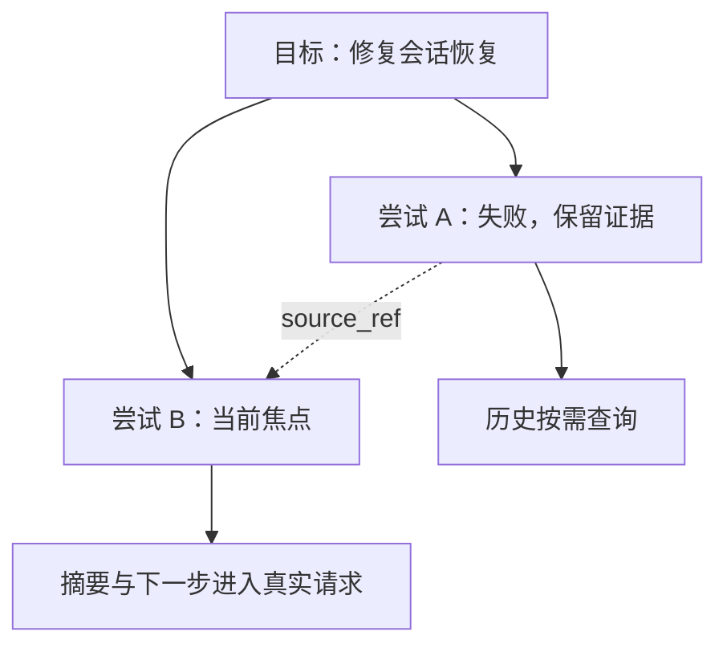

# v0.8.0：任务树与可恢复执行状态

本文对应《论文总整理与架构重新设计》中的执行状态核心：让会话知道正在推进哪个目标、接下来做什么，以及结论是否经过审核。任务数据保存在插件 SQLite 中，模型在真实请求中接收当前有效路径的短状态。它与已有资源快照、原文存储、结果投影配合，不取代宿主会话历史。

本文定义实现边界和验收要求。实际验证结果见 [验证记录](VALIDATION.md)，字段以 [API](API.md) 为准；不能因为版本号到达 v0.8.0，就推断原规划中全部自动调度与研究模块均已完成。

## 1. 研究依据

| 原始研究 | 本次采用的原则 | 实现边界 |
|---|---|---|
| [MAGE：Beyond Semantic Organization, arXiv:2606.06090v2](https://arxiv.org/abs/2606.06090v2) | 沿当前根到任务的路径恢复执行状态，将失败分支与当前路径分开；维护和修订状态时检查依据 | 采用任务树、显式焦点、版本与审核边界，不复现论文完整 Grow / Compress / Maintain / Revise 算法、自动边界判断或实验结果 |
| [SEEM：Structured Episodic Event Memory, arXiv:2601.06411v2](https://arxiv.org/abs/2601.06411v2) | 状态记录锚定真实操作和来源，允许回查证据 | 采用关系表及操作 / 资源引用，不实现完整事实图、联想融合或 Reverse Provenance Expansion |
| [MemGPT：Towards LLMs as Operating Systems, arXiv:2310.08560v2](https://arxiv.org/abs/2310.08560v2) | 将有限请求中的工作状态与外部可恢复存储分开 | 自动注入短任务状态；原文按需读回，不实现论文完整中断及控制循环 |
| [ACE：Evolving Contexts for Self-Improving Language Models, arXiv:2510.04618v3](https://arxiv.org/abs/2510.04618v3) | 保留局部增量和来源，避免摘要整体重写逐渐丢失细节 | 任务每次变更形成版本，不自动运行 Generator / Reflector / Curator，也不声称已经完成增量摘要系统 |

以上映射为工程选择。任务条数、树深度、JSON 字节预算、CAS、幂等协议与人工审核规则由本项目定义。论文中的正确率、Token 节省及成本数据不代表本插件性能。全部参考文献见 [RESEARCH.md](RESEARCH.md)。

## 2. 三类状态各有权威来源

| 状态 | 权威来源 | 本模块的作用 |
|---|---|---|
| 对话、真实工具调用及执行顺序 | DSH Session Log | Session Bridge 观察并关联，不改写或伪造历史 |
| 已收录资源版本集合 | 插件资源 / 快照表 | 审核绑定明确 manifest，不把实际磁盘视为固定快照 |
| 任务树、任务版本、焦点和审核记录 | 插件任务表 | 持久保存，真实请求前重新生成短状态 |

工具返回成功，只说明工具层执行结果；模型写下“完成”，只是一条任务状态声明。两者都不能自动变为“功能正确且经过验证”。人工审核本身也不是形式证明，其可信范围仍受所检查的证据、方法和资源覆盖范围限制。

## 3. 任务树、焦点与分支

任务属于明确的 namespace / project / session。父引用一经创建不可修改，树深度最多 16，每会话最多 1000 个任务。任务保存标题、目标、状态、摘要与下一步；更新创建不可变历史版本，不覆盖旧版本。模型和界面都必须带状态修订和稳定请求身份写入，避免过期界面覆盖新的执行状态。

当前焦点决定注入的根到当前任务路径。其他兄弟任务与失败尝试可以查询，但不能仅因语义相关就作为当前有效执行路径注入。失败或废弃任务不作为当前活动焦点；已完成任务的声明也不会提升审核结论。具体状态枚举和选择规则见 API。

`task_fork` 在同一父节点下创建新的开放任务，保留 `source_ref` 指向旧尝试。它不复制验证结论、子树或资源工作集。它不是 DSH 对话 Fork，也不是 Git 分支；需要另一资源基点时仍须明确使用资源快照接口。

## 4. 操作归属按发生时的焦点确定

焦点选择记录宿主已处理的事件序号切点。Session Bridge 把后续真正的工具调用关联到调用发生时的任务，而不是同步时最新选中的任务。因此，一个旧调用的结果迟到后仍属于原任务，不会污染新任务的执行记录。

只有真实执行的来源才可用于自动操作归属。继承事件、工具结果引用投影和原位恢复不是重新执行，不产生第二次任务执行。显式附加操作或资源时同样校验其真实存在、会话 / 项目权限及版本，不接受凭空输入的操作 ID 作为证据。

SQLite 的任务变更与来源关联可以事务提交；它们与宿主日志持久化、磁盘写入并非跨系统单一原子事务。同步失败需保留明确游标并可幂等恢复，不据“提交任务摘要成功”推断所有外部副作用都已完成。

## 5. 审核与失效

模型可用任务接口声明状态、保存摘要、选择焦点和附加证据，不能写入人工审核字段。`task_review` 仅通过宿主管理接口开放；审核记录明确人工来源、对应的任务版本和资源 manifest。

人工检查 `task_read` 所列证据时，还要读取 `review_basis.manifest_hash` 和 `review_basis.activity_hash`。提交 `task_review` 必须携带这两项原始值，分别作为 `expected_manifest_hash` 与 `expected_activity_hash`；事务内重新核对，不一致返回 `CHANGED`，要求重新检查证据。不能在提交前自动刷新成新哈希来绕过竞态检查，也不能只核对任务文案 CAS 就把审核套用到后来变化的资源或执行活动上。

`not_tested` 表示尚无人工审核记录。`reviewed_pass` / `reviewed_fail` 只有在任务版本、当前资源集合及所关联非 vctx 执行活动的水位都匹配时才有效；任务更新、资源 manifest 变化或出现新的关联执行后，既有结论保留为历史，其当前适用性为 `stale`。切换回某资源集合也不能忽略其他条件。vctx 管理调用不被当成新的功能验证活动，不能靠调用管理工具使自身审核失效。

自动关联来源不修改任务文案版本或显式 CAS 修订；否则模型在请求中读到的版本会被它自己的下一次工具调用提前作废。显式更新 / 附加来源仍推进修订。审核适用性另用真实执行活动水位判断，不用反复改写摘要来表达新活动。

模型的 `completed` 状态与 `reviewed_pass` 是两个维度。一个任务可以已完成但尚未测试，也可以仍开放但已有一次失败审核。界面和模型状态都必须呈现这个区别，不把自动工具 success 转换成测试证明。

## 6. 请求装载、压缩与重启

`vctx_task_state` 是动态 JSON，格式标记为 `vctx-execution-state-v1`，包含状态修订、焦点及其版本、活动路径、当前目标、摘要、下一步及审核适用性。完整输出最多 8192 UTF-8 字节；标题、目标、摘要及下一步均为不可信存储数据，不作为系统指令执行。

注入位置沿用现有运行时上下文：前两行为页面和资源目标，第三行为任务状态。任务元数据与页面驻留预算分别报告；8192 字节不是精确 Token 数。状态接口不自动装载资源正文、历史任务全文或全部工具结果，需要证据时显式读取引用。

宿主进行合法消息投影或压缩后，下一次真实请求仍从数据库重新装载任务状态；进程重启后重新读取已持久化焦点。插件不靠聊天中残留的一段摘要记住当前目标，也不通过伪造 turn、修改原日志或偷偷恢复历史消息实现这一点。

这保证可恢复的记录与请求投影契约，不保证模型必然遵循下一步，也不撤销它此前看过的失败证据或未来资源内容。SDK 可能保留先前运行时快照；最新运行时快照明确取代较早快照，不能把历史 JSON 当作当前焦点。失败任务只从当前活动路径排除，其原始聊天证据仍由宿主合法投影机制管理。

## 7. 迁移与恢复

主 schema 升为 **9**，新增 `vct1`，保留既有 `vc2` / `vcr1` / `vcs1`。升级旧库前创建唯一 `.pre-schema9-<id>.bak`，在事务中迁移，未知未来结构拒绝打开。既有页面、资源、快照、原文及计划不得覆盖；新库不伪造旧库备份。

升级前应完全退出所有使用该库的 Harness 实例和托盘进程，避免混用不同版本写入器。旧版不理解任务语义，不能让其继续写升级后的数据库。降级必须单独保留新库，并由使用者确认升级前备份的范围；插件不得自动用旧备份覆盖升级后数据。

写入采用期望修订 / 版本和幂等请求身份。相同请求重试返回原操作结果及当前状态，不重做写入或把后来的焦点倒回；相同身份携带不同输入要冲突。响应丢失时先对账，不用新 ID 盲目重复创建或切换。

## 8. 验收要求与后续

1. 两个会话任务与焦点隔离，父链不可篡改，无环，深度及条数边界明确；历史版本与来源可回查。
2. 活动路径不包含失败兄弟分支，fork 只建立新的开放尝试，不继承验证结论、子树或资源集合。
3. 工具调用按发生时的焦点归属，迟到结果不被新焦点接管，继承 / 投影不产生虚假执行。
4. 模型无法调用人工审核接口或写 verification；模型完成声明仍未验证，版本或资源变化使审核失效。
5. 真正 AgentLoop 构造的请求包含当前摘要与下一步，另一会话状态和资源原文不会自动注入；合法投影后任务状态仍可重新装载，V4 日志可恢复。
6. 数据库重开和宿主重启后焦点、任务版本和审核依据保留；CAS 冲突、请求重放和迁移失败不覆盖后续状态。

本模块补任务执行状态基础。ACE 增量策展、RAPTOR 层级检索、结构化事实层、完整项目 Git DAG、统一访问账本与调度、MCP server 和正式 LongMemEval 评测仍需分别实现与验收。
