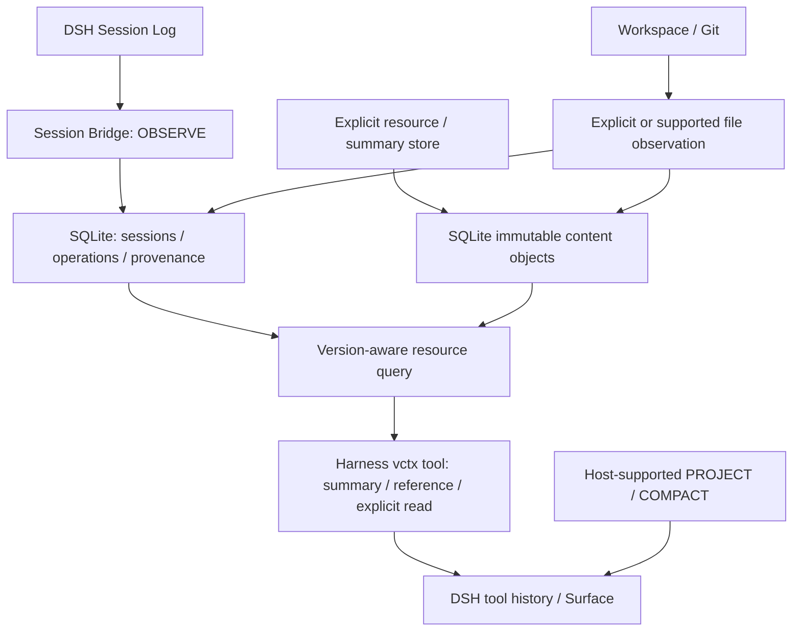

# v0.5.0：结构化状态与可恢复证据

本文记录 v0.5.0 契约。后续开发中的单条工具结果引用投影及原位恢复见 [PROJECTION-0.6.0.md](PROJECTION-0.6.0.md)；它与本文保留的宿主摘要压缩是两条不同路径，不倒推为 v0.5.0 已有能力。

本次将现有页面内核扩展为“结构化事件 + 版本化资源 + 有来源的摘要”，保留原有 SQLite 页面、修订、换页、检查点及宿主压缩路径。它是后续任务树、会话快照和工作集调度的基础，不一次实现全部研究功能。

研究清单及具体版本见 [RESEARCH.md](../research/RESEARCH.md)。以下设计借鉴 MemGPT、GCC、MAGE、ACE 与 SEEM，关系模型、幂等约束和资源格式由本项目定义，不声称复现论文算法。

## 1. 权威边界

| 数据 | 权威来源 | 插件职责 |
|---|---|---|
| DSH 原始会话与事件次序 | DSH Session Log | 记录会话 ID、事件 seq、工具调用标识及同步进度，不改写原始日志 |
| 项目当前实际文件 | 工作目录 / 项目 Git | 记录观测到的内容及观测时点，不擅自 checkout、提交或覆盖文件 |
| 插件操作、摘要、资源元数据 | 插件 SQLite | 保证约束、幂等、scope 隔离、来源和恢复引用 |
| 显式保存的资源及摘要全文 | 同一 SQLite 中的不可变内容对象 | 写入时计算 SHA-256 去重，读回校验哈希与长度，摘要不覆盖原文 |
| 当前模型可见内容 | DSH Surface 与实际请求 | 观察当前投影及最后请求，改变历史可见性走宿主机制 |
| 供应商 Token 与缓存量 | 实际模型 Usage | 聚合可观察字段，缺失数据不填成零 |

插件不成为第二套完整 DSH 日志。Bridge 只保存白名单事件元数据，不复制原始工具参数、工具结果或模型消息；原始证据仍需从 DSH 日志读取。显式资源存储与文件捕获才建立全文对象。原始会话的身份、生命周期、持久化及投影仍由宿主决定。[SEEM](https://arxiv.org/abs/2601.06411v2) 提供来源锚定的研究依据，[MemGPT](https://arxiv.org/abs/2310.08560v2) 提供外部存储和有限窗口分离的研究依据。

## 2. 会话状态与项目状态

`Project HEAD != Session Snapshot`。项目最新文件不能悄悄替换另一个会话已经引用的历史版本。资源读回以明确版本和内容哈希定位，跨会话不隐式共享当前驻留状态。[GCC](https://arxiv.org/abs/2508.00031) 和 [ChronoMem](https://arxiv.org/abs/2607.27773v2) 启发版本可选择、历史可追溯的设计；本次不实现 Git DAG、合并或自然语言全局回滚。

v0.5.0 固化会话的 `project_id / root_path / target_commit` 绑定，初期 `target_commit` 可以为空。同一 scope 中每个资源路径有独立当前指针，显式版本引用不随该指针变化；不同 scope 不自动跟随同一项目 HEAD。完整 Session Snapshot、跟随 HEAD 策略、Fork 版本集合和分支冲突解决属于后续功能。旧页面检查点恢复的是插件页面状态，不会恢复工作目录、Git 分支、结构化资源快照或 DSH 原始会话。

对文件的记录必须区分两种证据：

- **工具操作证据**：宿主记录该工具调用及结果，能证明调用发生、返回了什么；不能仅凭工具名称推断文件已改变。
- **文件内容观测**：插件实际读取或收到明确提交的某版内容，哈希标识这次捕获的文本；没有修改前内容时不得补造 before_hash。

历史工具结果不等于今天磁盘上的文件。回放旧事件时读取当前磁盘，只能称“回放时观测”，不能当作旧事件执行时的文件版本。并发编辑后的读回也不是跨系统原子快照。缺失信息以 unknown / 未捕获表示。

## 3. 操作、资源与摘要

操作记录连接 session、DSH seq、工具调用标识、状态和来源，只保存允许的结构化元数据。`operation_read` 读取该索引记录，不假称读到了原始工具结果全文。显式资源及摘要的文本保留为同一 SQLite 内的不可变对象；默认写入返回引用，显式读取才装载全文。内容相同可以去重，来源和版本身份仍独立保存。本次没有独立文件对象目录或 Git 内容后端。

`verification` 和执行状态分开：工具成功只记录 `succeeded`，不提升为 verified；失败、取消、结果缺失不能变成 confirmed。模型提交的摘要只允许 `verification=not_tested`。有证据的验证状态维护留待后续，避免工具自己宣称已验证。这是对 [MAGE Maintain](https://arxiv.org/html/2606.06090v2) 的工程借鉴，而不是已实现完整任务执行树。

摘要是派生记录，带独立身份和来源链接，通过明确资源版本引用关联证据，不覆盖原文；来源变化时旧摘要仍是历史记录，不自动变成当前事实。`summary_store` 接收调用者提供的摘要文本，本次不会自动生成摘要。[ACE](https://arxiv.org/abs/2510.04618v3) 启发局部增量，[RAPTOR](https://arxiv.org/abs/2401.18059v1) 提供未来层级检索方向；本次不自动运行摘要模型、递归聚类或事实三元组抽取。

## 4. 同步、幂等与恢复

DSH 日志、文件系统与插件数据库没有跨系统单一事务。插件只能在自己的 SQLite 事务中提交记录及游标，不能声称同步提交项目文件和宿主日志。

同步应满足以下可测试约束：

1. 同一会话事件重放保持同一操作身份，不新增重复记录。
2. 同一身份收到不同内容时报告冲突，不静默改写已记录证据。
3. 记录与游标同事务提交；处理中断后可从已提交进度继续。
4. 来源事件缺失、不可读或不受支持时报告可观察状态，不把“未读取”标成“已同步”。
5. Bridge 对宿主可用的活跃会话从 seq 0 连续重放历史，按 128 条事件分批推进，不只监听新产生的工具结果。非活跃会话的看板只读历史能力仍独立存在；不把它假称为所有冷会话已自动同步。
6. 查询和重放受 scope、数量和内容大小约束；后台失败不会吞掉原工具结果或阻塞宿主正常执行。

每次同步只解析已确认 cursor 的边界元数据及新增后缀，并让数据库核对边界哈希，避免每个新事件重新解析整段历史。宿主负责已接受历史的不可变性；插件不会声称检测所有旧正文或整个旧前缀的任意篡改。SessionQuery 的完整观察切片仍由宿主提供，一次只处理一个会话，不把元数据增量解析等同于宿主零拷贝。

幂等只解决插件写入的重复性。它不意味着取消后原工具没有执行，也不意味着失败重试可以安全重新运行文件修改。同步从宿主已有证据恢复，避免重新执行原工具。

继承的历史前缀标记为 `inherited`，不把父会话操作再次归入子会话的自有操作。重放游标表示已处理的日志位置，不是操作条数；非工具事件也必须按位置检查，不能因筛选操作而跳过中间证据。

Native 与 PTC 子调用分别保留 `execution_kind=native|ptc`，同一个原始 call ID 在两类域中互不混淆。`tool/ptc-dispatch-start` 与 `tool/ptc-dispatch` 也形成操作索引。原生 Surface replacement 仅记录 `projection=true` 证据，不冒充第二次工具执行，也不把结果修剪提升为验证通过。

### 4.1 本次存储与 API

`vcontext/state.py` 的 `StructuredState` 与原页面内核共用 SQLite。schema 6 前向迁移到 schema 7，结构化表使用 `vc_*` 前缀，保留原有表和接口。

| 表 | 保存的信息 |
|---|---|
| `vc_projects / vc_sessions` | namespace 下的项目根、固定会话绑定、同步游标 |
| `vc_events / vc_operations` | 连续事件白名单、工具调用与结果 seq、操作状态 |
| `vc_objects` | 按 UTF-8 内容 SHA-256 去重的不可变文本及字符 / 字节数 |
| `vc_resources / vc_current_resources` | 不可变版本、父版本、观测来源及本会话当前路径指针 |
| `vc_summaries / vc_summary_sources` | 调用者提供的摘要、验证标记及有序资源来源 |
| `vc_requests` | request_id 指纹与已提交结果，用于资源 / 摘要写入重试 |
| `vc_schema` | 结构化子模型版本 2；与主数据库 schema 7 区分。未发布草稿版本 1 明确拒绝，不擅自重建 |

不提前创建 `tasks / commits / commit_parents / facts` 等尚无完整行为的表，避免把空表当成已实现能力。

| 操作 | 入口与结果 | 边界 |
|---|---|---|
| `state_bind` / `state_sync` | 宿主 Bridge 固定绑定、同步事件和游标 | 仅内部使用，模型不能伪造宿主事件 |
| `state_status` | 查看绑定、同步进度与结构化存储状态 | 不等于原生会话已经压缩 |
| `operation_list` / `operation_read` | 列出或读取白名单操作索引 | 不返回原始工具参数、结果或消息全文 |
| `resource_store` | 以 `request_id / path / content / expected_ref` 提交不可变版本；可关联 `operation_id` | CAS 防止覆盖并发更新；关联操作不证明因果关系 |
| `resource_read` / `resource_history` | 以 `ref` 或当前路径读取，支持 `offset / limit`；列出历史引用 | 明确 ref 固定版本，path 读取本 scope 当前指针 |
| `summary_store` / `summary_read` | 保存或读取摘要及来源版本引用，指定 `level` | `verification` 仅允许 `not_tested`，不自动调用模型 |
| `resource_capture` | 宿主工具读取显式相对路径，保存完整 UTF-8 文件，返回 ref / hash | 默认关闭，宿主显式启用 `resourceCapture` 后，经宿主 fs 后端有界读取；拒绝越界、符号链接逃逸、过大或二进制内容 |

`resource_capture` 只记录捕获时点。`source_revision=working-tree:sha256:<digest>` 表示内容观测标识，不是 Git commit。模型的 `resource_store` 不能提供该宿主来源字段；调用者提交文本与宿主捕获分开。可关联 `operation_id` 帮助追溯，但不会证明该操作是文件变化的唯一原因。捕获要求宿主 fs 能映射同一工作目录，并通过 `contains / stat / readBytes` 处理，读前后版本不同则拒绝；无 Node 文件读取后备。它不扫描整个仓库、不改文件、不创建 Git 提交。具体输入上限和返回字段以 [API](../guides/API.md) 为准。

持久化调用者提供的正文意味着该内容会保存在插件数据库中；自动 Bridge 元数据同步不等于自动复制所有会话正文。操作、摘要、路径当前指针和历史列表按会话隔离；明确的资源 `ref` 可以在同 namespace、同 project 的会话间共享读取和作为摘要来源，不能跨项目或 namespace 读取。这种显式共享不改变接收会话的路径当前指针。

## 5. OBSERVE、STORE 与 PROJECT / COMPACT

| 模式 | 操作结果 | 不应推断的结果 |
|---|---|---|
| OBSERVE | 读事件、请求、版本元数据，建立来源关联 | 没有因此减少真实请求 Token |
| STORE | 存全文与元数据，返回摘要或版本引用 | 原始 tool/result 中已经出现的全文仍可能驻留 |
| PROJECT / COMPACT | 经宿主支持的投影、修剪或压缩改变可见内容 | 插件数据库归档不等于宿主压缩成功 |

v0.4.0 的“会话上下文替换”继续走 Harness 官方压缩，见 [REPLACEMENT-0.4.0.md](REPLACEMENT-0.4.0.md)。本次 Bridge 不自动压缩旧工具结果，不删会话日志；错误栈、测试结果和关键证据应先保留，未来再按任务及版本有效性调度。

资源引用是插件内部协议标识，不因使用 `vctx://` 语法就成为已注册的 MCP Resources 服务。当前访问入口及具体字段以 [API.md](../guides/API.md) 的实际操作为准。MCP 或其他宿主工具读回的文本仍会进入正常工具历史，后续驻留生命周期需要另行管理。

## 6. 指标口径

| 指标 | 口径 | v0.5.0 限制 |
|---|---|---|
| Provider Cache Hit Rate | cache_read_tokens / 可统计 input_tokens | 依赖供应商返回字段，不由页面命中推算 |
| Virtual Context Hit Rate | 已驻留且版本正确的访问 / 可观察有效需求 | 不能把 search → read → page_in 当成三次独立需求；新结构化资源未接入的部分不能冒充完整资源命中率 |
| Actual Context Size | 最后实际请求的 Usage，调用前估算另列 | deriveMessages 字节和保守预算不是精确 Token 数 |
| Virtual Context Size | 可恢复版本资源的逻辑规模 | 同一内容被多个版本引用时，要区分逻辑引用量和去重内容量 |
| Physical Storage Size | SQLite 主文件及 WAL 等实际占用 | 本次对象在 SQLite 内；不能用正文字符数假称整个物理数据库大小 |

本次主要补齐可追溯存储与操作证据，不宣称已完成上述全部资源指标。未来评测联合报告任务正确性、恢复质量、Token、延迟与存储成本。[LongMemEval](https://arxiv.org/abs/2410.10813v2) 和 [LongMemEval-V2](https://arxiv.org/abs/2605.12493v1) 提供能力分类；本项目没有它们的正式基准分数。

## 7. 兼容性与验收

迁移采用附加结构，不重建或覆盖已有数据库。旧页面、修订、驻留层、配置、检查点与供应商 Usage 保留；未知未来 schema 应拒绝打开。首次打开已发布 schema 1–6 的磁盘库时，先通过 SQLite backup 生成同目录唯一命名的 `.pre-schema7-<id>.bak`，再在单一 SQLite 事务中迁移；失败回滚，已有备份不会覆盖。回退旧插件应先关闭宿主并人工选择备份恢复，不自动替换数据库。验证采用临时数据库或明确隔离的演示会话。

本次需要验证：旧 schema 前向迁移与旧数据读回、同一批事件二次重放、冲突回滚、取消及失败状态、内容哈希与不可变约束、显式历史版本读取、摘要来源恢复、会话路径隔离与同项目显式共享、工具与路由输入限制。真实宿主回放应核对原始日志没有被改写，并区分数据同步成功和原生 UI 验收。

## 8. 本次之外

后续按独立策略逐步接入：会话版本集合、任务树和有效路径、验证结果维护、层级摘要、版本有效性与任务相关性过滤、FTS5 / 向量索引及自动工作集调度。预算选择先检查版本、任务和可访问性，再比较效用与装载成本；初始可用确定性贪心，不把未经评测的评分式称为论文最优算法。

[DiffMem](https://github.com/Growth-Kinetics/DiffMem) 的当前状态 / Git 历史分离可作工程参考；[Zep](https://arxiv.org/abs/2501.13956v1) 的时间关系和 [A-MEM](https://arxiv.org/abs/2502.12110v11) 的关联笔记可为未来事实层提供依据。当前不引入独立图数据库、服务端 KV cache 调度或训练记忆策略。
