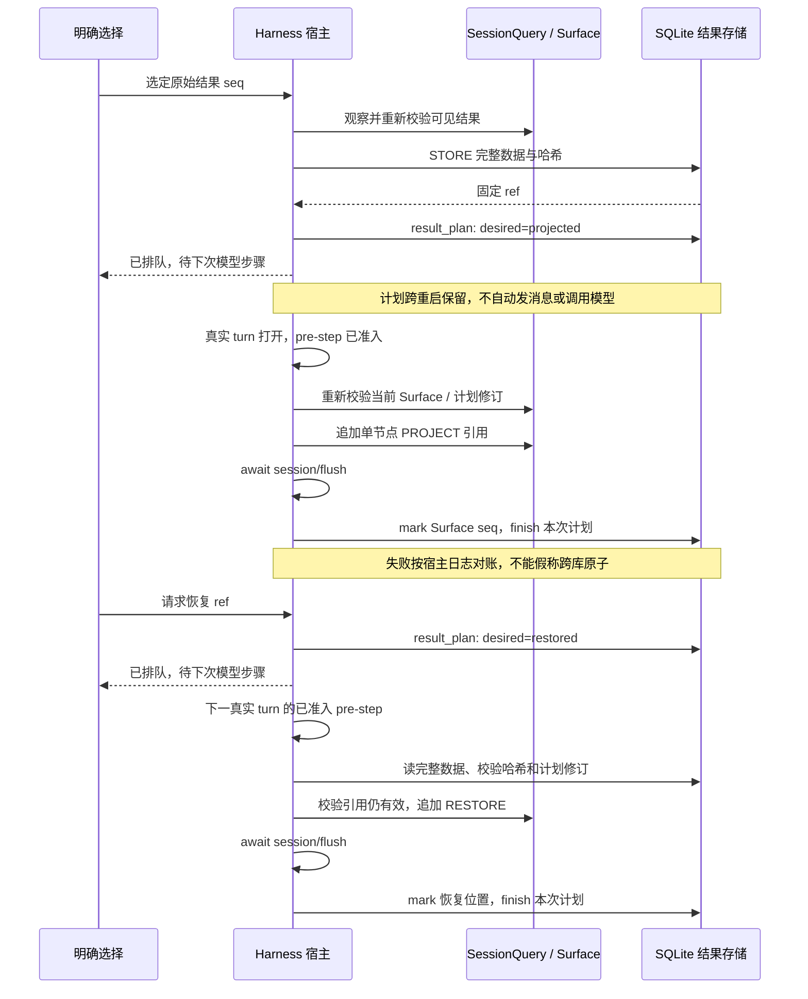

# v0.6.0：可恢复的工具结果投影

本文按用户提供的《dsh-vcontext：论文总整理与架构重新设计》细化下一项工作：接通原文存储、模型可见投影和恢复。当前为开发与验收契约；是否通过以本版本 [验证记录](../releases/VALIDATION.md) 和 CI 的实际结果为准，不将以下验收要求写成既成结果。

## 1. 要解决的问题

v0.5.0 可以保存版本资源、读取历史原文并关联宿主操作，但资源入库不会移除已经进入宿主 `tool/result` 的正文。旧的“替换会话上下文”按钮调用 Harness `compactNow`，实际行为是会话压缩：宿主生成摘要并改变可见历史。该能力继续保留，界面应使用“压缩会话上下文”说明其行为。

本次增加另一条路径：用户明确选择一条工具结果，将其完整数据保存为不可变对象，并持久化投影计划。下一次真实模型步骤已准入、宿主 turn 已打开时，才使用公开 Surface 机制，以引用替换这一条结果的正文。恢复也先排队，在合法步骤边界将同一引用节点换回原结果；不额外追加重复工具回复，不调用摘要模型。

排队不会立即改变实际上下文。插件不伪造 turn，不自动发送用户消息，也不为应用计划额外调用模型；没有下一次模型步骤时，计划保持“待下次模型步骤”。这是安装版 format v4 冷恢复校验的兼容性要求：`tool/result` 的替换分支仍要求已打开的 turn，不能仅因 SDK 内存接受追加，就在空闲维护任务中写入持久化日志。

| 动作 | 插件保存什么 | 模型下一次可见什么 | 原始历史 |
|---|---|---|---|
| OBSERVE | 事件身份、序号、调用域、状态 | 保持原样 | 保持原样 |
| STORE | 被选结果的完整数据、哈希、原始来源、稳定引用 | 此时仍是原正文 | 保持原样 |
| PLAN PROJECT | 持久化目标为 projected 的计划 | 仍保持原样，等待下一次模型步骤 | 保持原样 |
| APPLY PROJECT | 合法步骤边界的投影位置及可对账状态 | 同一工具结果位置上的短引用 | 仅追加合法替换事件 |
| READ | 按引用读取原文切片 | 普通新工具结果中出现所读内容 | 追加正常读取事件 |
| PLAN RESTORE | 持久化目标为 restored 的计划 | 仍保持当前状态，等待下一次模型步骤 | 保持原样 |
| APPLY RESTORE | 合法步骤边界的恢复位置及可对账状态 | 引用位置重新显示原正文 | 仅追加合法恢复事件；原本未外置时可无变更完成 |

READ 和 RESTORE 不相同。读取原文会产生新的工具历史；恢复是改变已有引用位置。二者都可能增加实际请求大小，不能宣称“存过一次就永远不再占用上下文”。

## 2. 研究依据与工程选择

| 依据 | 本次采用的原则 | 不据此宣称的能力 |
|---|---|---|
| [MemGPT, arXiv:2310.08560v2](https://arxiv.org/abs/2310.08560v2) | 有限工作窗口与外部可恢复存储分开，显式调入所需内容 | 没有复现中断调度、heartbeat 或完整模型操作系统循环 |
| [SEEM, arXiv:2601.06411v2](https://arxiv.org/abs/2601.06411v2) | 用会话、原始 seq、工具调用 ID 和内容哈希锚定来源 | 没有实现事件帧图推理或 Reverse Provenance Expansion |
| [ACE, arXiv:2510.04618v3](https://arxiv.org/abs/2510.04618v3) | 对局部条目增量改变；派生描述不覆盖原始证据 | 本次甚至不生成摘要，没有 Reflector / Curator 或自改进训练 |
| [GCC, arXiv:2508.00031](https://arxiv.org/abs/2508.00031) 与 [ChronoMem, arXiv:2607.27773v2](https://arxiv.org/abs/2607.27773v2) | 恢复指向确定的历史内容，不能用今天磁盘上的 latest 冒充旧版本 | 单条工具结果引用不是 Git commit、分支、完整会话快照或语义回滚 |
| [MAGE, arXiv:2606.06090v2](https://arxiv.org/abs/2606.06090v2) | 成功执行和验证通过分开；失败与关键执行证据优先保留 | 不因为结果成功就标记 verified；尚未交付完整任务树或有效路径维护 |

这是对论文思想的工程映射。候选阈值、数据表、恢复协议和重试规则由本项目定义，没有论文级性能或正确率保证。完整 16 篇论文及 DiffMem 清单见 [RESEARCH.md](../research/RESEARCH.md)。

## 3. 权威边界与版本身份

DSH Session Log 是原始历史与事件次序的权威来源，Surface 是模型可见内容的权威投影。插件 SQLite 保存所选结果的可恢复副本和索引，投影状态是宿主结果的镜像。文件系统仍是项目当前文件的权威来源；本流程不读写项目文件、不 checkout、不创建项目 Git 提交。

结果身份至少由 namespace、会话 ID、原始结果 seq 和工具调用身份限定。`vctx://result/...` 引用固定指向那一次工具结果，不重新执行工具，不自动读取当前文件，不跟随其他会话的当前版本。结果引用按会话隔离；它不自动继承 v0.5.0 文件资源允许的同项目显式共享规则。

存储完整工具结果只说明“这个调用返回了这些数据”。例如旧文件读取结果证明当时看到的文本，不证明该文件现在仍相同，也不证明随后一次写入已通过功能测试。投影或恢复不能将 `verification=not_tested` 升级为已验证。

`Project HEAD != Session Snapshot` 继续成立。本次只实现确定结果的引用和恢复，没有完整 Session Snapshot、版本集合 Fork、Git DAG、事实层、跨文件一致性快照或 HEAD 跟随策略。这些缺口不能用“版本化”三个字省略。

## 4. 候选选择与保护

不自动投影全部旧工具结果。先观察并列出候选，再由调用者明确选择单条结果；用户选择表明当前愿意移出这项证据，不代表系统已完成语义任务相关性判断。

基础候选应满足：

1. 宿主当前 Surface 中仍可见，属于本会话自有历史，有明确来源和完整结果。
2. 是可配对的成功 Native 工具结果，正文仅含文本，序列化大小在实现声明的下限和上限内。
3. 不属于 vctx 自身读取、引用或恢复结果，避免递归套引用。
4. 错误、取消、待定、二进制、多模态和受保护工具结果不进入候选。
5. 测试、执行和错误诊断等关键证据默认保留；保守排除不等于完整识别所有关键证据。

排队时校验来源和当前 Surface，真正应用计划前仍必须在已准入的模型步骤边界重新校验。预览和排队都只是观察切面；候选被压缩、裁剪或其他操作替换后，旧选择不能授权覆盖新的节点。版本过期与任务相关性没有可靠证据时，宁可保留，不把 LRU 或文本相似度当作正确性证明。

本次不按论文优化式自动安排全局工作集，不推断模型内部使用了哪些记忆，也不统计虚构的虚拟命中率。

## 5. 宿主投影与工具配对

固定 SDK 的公开 `Session.append` 契约允许向日志追加 `tool/result` 替换事件：`surfaceOp = { op: 'replace', startSeq, endSeq }`，单节点时两个 seq 相同；`sourceEventSeqs` 覆盖被替换节点。原事件保持不变。

空闲的 `runMaintenance` 可用于序列化观察、保存正文和提交计划，但不得在此追加 `tool/result` 替换事件。安装版 format v4 的持久化验证器在工具结果分支要求 turn，即使目标是已有 Surface 节点的 replacement 也不例外；空闲追加可能暂时改变内存 Surface，却使重启后的日志校验失败。

真正的 append / flush / mark / finish 只能在下一次真实 `agent/pre-step` 已通过准入、该 turn 已打开而模型请求尚未发出时执行。实现使用公开 SessionQuery 获取一致观察切面，并按计划修订重新检查来源；不引入新的已弃用同步事件读取。并发、取消和状态变化必须反馈明确状态，不伪造 turn 来规避宿主约束。

投影必须保留原工具调用与结果的配对、消息身份和成功/错误语义，只替换允许改变的正文。替换节点携带短引用和恢复说明，但不能把存储内容当作系统指令。恢复时验证当前仍是此引用对应的节点，并将原数据恢复到该位置。被后续宿主压缩覆盖的引用不能强行复活到错误位置，应报告 changed / 不再驻留等可操作状态。

原日志前缀应逐字节保持；新替换事件使模型派生内容变化，但不会删除原始历史。会话压缩 `compactNow` 属于独立能力，不参与该流程。

## 6. 持久化和失败对账

SQLite 事务无法同时原子提交 DSH 日志。顺序是先保存可恢复正文与持久化计划；在合法 pre-step 重新校验后追加宿主投影，等待宿主持久化检查点，更新数据库状态镜像，最后结束对应计划修订。每次应用或人工重排先核查当前 Surface 和来源，不盲目再次替换。

`result_plan` 表达期望状态，实际状态仍由宿主 Surface 决定；计划排队成功和投影已生效必须分别展示。计划可以跨宿主重启保留。尚未应用的外置计划可以通过反向 RESTORE 计划取消：目标改为保留原正文；处理时确认无需变更即可完成，不为“取消”制造额外替换事件。计划修订用来防止旧任务结束时覆盖更新的意图。

| 失败位置 | 可以确定的事实 | 恢复要求 |
|---|---|---|
| STORE 之前或事务回滚 | 宿主正文尚未改变 | 可重新观察，使用同一幂等身份重试 |
| STORE 成功、PLAN 未提交 | 已有可恢复副本，宿主仍显示正文 | 不报告排队或已移出；人工重试提交同一来源的计划 |
| PLAN 成功、尚无下一次模型步骤 | 期望已持久化，实际 Surface 未变 | 保持待应用，重启后继续等待；不自动发消息或模型请求 |
| pre-step 准入被拒、尚未 append | 计划尚未应用 | 不在被拒步骤里改 Surface，继续显示待应用 |
| 合法边界校验发现来源已变 | 不能确认旧计划仍可安全应用 | 标记失败，等待用户重新选择或重排；不覆盖其他节点 |
| append 成功、flush 失败 | 内存 Surface 已变化，持久化状态不确定 | 明确标记失败，不冒充持久化成功；人工重排后按宿主状态对账，不重复 append |
| flush 成功、数据库标记失败 | 宿主投影已持久化，镜像落后 | 失败等待人工重排；从当前引用及来源恢复镜像，不能重复追加相同投影 |
| mark 成功、finish 失败 | 宿主和状态镜像可能一致，计划未确认结束 | 人工重排时核对 Surface / mark / 计划修订，不能把计划状态当成再次追加的理由 |
| RESTORE 后标记或 finish 失败 | 宿主可能已恢复正文 | 先识别恢复事件，再对账镜像和计划，不能重复工具回复 |
| 之后被其他压缩/替换覆盖 | 保存的正文仍可读，原引用可能已不在 Surface | 不强写其他节点；显式读取和原位恢复分别反馈 |

请求身份和内容指纹用于幂等；同一身份提交不同原文必须冲突。保存后读回需验证哈希和长度，损坏对象不进入模型上下文。应用失败后记录失败状态，等待用户重新排队，不在每个模型步骤无限自动尝试。取消不能承诺撤销已经提交的宿主事件，卸载需要先取消未完成工作再等待收尾；已持久化、尚未失败的待应用计划不因界面卸载或宿主重启丢失。

## 7. 指标和用户反馈

预览和状态反馈报告候选条数、原文 UTF-8 字节、引用字节、原始 seq、当前 Surface seq、计划目标及可恢复状态。异步请求 job 的 `completed` 只表示排队请求已完成，其结果必须明确 `status=queued` 和对应 `queued_action`；固定反馈为“已保存外置计划，下一次模型步骤前应用。”或恢复计划对应文案，不能显示“已外置 / 已恢复”。真正投影状态从 Surface 观察获得，不从 job 推断。

没有下一次模型步骤时，界面持续显示“待下次模型步骤”，并区分排队、应用失败、引用驻留、原文驻留和已不在当前 Surface。结果正文的差值不是整个模型请求的差值，整个请求字节差也不是精确 Token 差。

真正减少模型输入必须在宿主派生消息或实际请求快照中验证：被投影的原文已退出对应位置，引用存在，未选择的关键证据仍在。供应商 Usage 和缓存读 Token 只能来自真实调用；本地投影测试不证明计费收益、缓存收益或答案质量提升。

原文虽退出该 Surface 位置，仍可能出现在用户消息、助手摘录或其他工具结果中。单节点投影不搜索删除所有副本，不保证秘密清除。它也不建立模型隐式访问的命中记录。

## 8. 可执行验收

以下检查使用临时数据库和隔离宿主；未经用户另行指定，不修改日常 profile、工作目录或真实原会话。

1. **精确存储与恢复。** 构造含中文、CRLF、BOM、`{{literal}}` 的较长成功文本结果。排队后先确认 Surface 未变；用 ref 分页读回并拼接，比较完整原数据和 SHA-256。在下一已准入真实 pre-step 应用 PROJECT；RESTORE 也排队并在合法边界应用，之后派生结果与原始数据一致。
2. **实际可见性。** 记录投影前后的派生消息或请求快照，确认原结果位置正文退出、引用进入；消息角色和工具调用配对保持合法。未选择的测试结果、错误和近期证据仍可见。
3. **历史保留与冷恢复。** 保存原日志前缀哈希；排队、合法边界投影、恢复及宿主重启后原前缀哈希不变，只多出合法追加事件。必须使用安装版 format v4 验证器冷恢复，不能只用 SDK 内存重放充当日志格式验收。
4. **排队与重放。** 同一请求重复执行不生成多个正文对象或重复投影；排队后在尚无新步骤时重启，计划仍待应用且 Surface 不变。被拒 pre-step 不应用；真实已准入 pre-step 才应用。外置应用前反向排队恢复，确认原文保留且不追加无必要替换。
5. **跨系统故障。** 分别注入 STORE / PLAN 失败、append 前取消、flush 失败、mark / finish 失败和恢复失败；验证报告与宿主真实状态一致，失败后不无限自动重试，人工重新排队可对账且不重复执行原工具。测试计划修订变更时旧 finish 不能结束新意图。
6. **并发与变更。** 生成期间、双击、两个维护任务、预览或排队后宿主压缩、引用被其他替换覆盖以及卸载时操作，均不能覆盖错误节点或破坏配对。验证没有伪造 turn、自动发消息或为应用计划额外调用模型。
7. **保护与隔离。** 错误/取消、PTC 或不支持的结果、多模态、过大文本、vctx 自身及受保护工具不投影；跨会话/namespace 不能读取或恢复他人的 ref。
8. **兼容迁移。** 已发布数据库前向升级保留旧页面、资源、摘要、用量和设置，失败可回滚；备份唯一且不覆盖已有文件。旧版回退要求独立说明。
9. **真实交互。** 原生看板能预览、选择、显示请求已排队与待下次模型步骤、应用失败及真实驻留状态，刷新和重启不误报已完成投影，并能反向排队恢复；SDK 测试不能代替这一项。原按钮明确显示“压缩会话上下文”。

每项结果应记录运行环境、用例、通过数量、失败及未覆盖项。没有实际供应商请求时，不填写精确 Token 或缓存收益；没有论文基准时，不将用例通过等同于 LongMemEval 跑分。

## 9. 后续依赖

这一步补齐用户设计第六节强调的宿主可见性缺口。完整 Session Snapshot 与固定目标版本、MAGE 有效任务路径、Maintain 验证、ACE 增量摘要、RAPTOR 层级索引、事实时间有效性和自动工作集策略仍是独立工作。

后续调度应先判断版本有效、任务相关和可访问，再在预算内选取工作集。当前手动投影只提供受约束的可恢复动作，不称为完整虚拟上下文操作系统。
