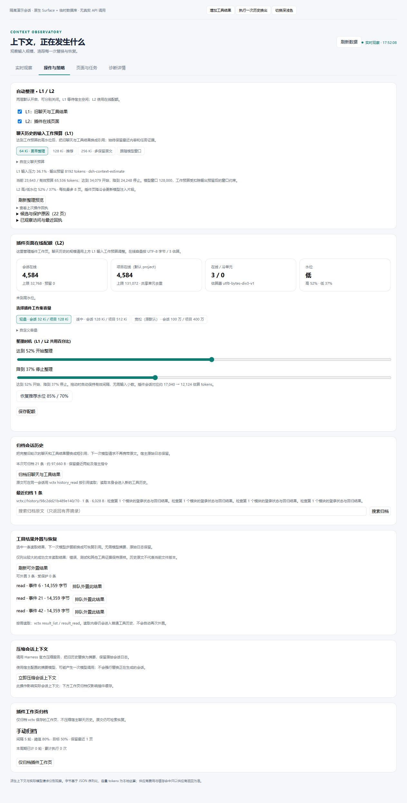

# 会话内界面：上下文缓存

## v0.15 预算与水位

“操作与策略”上方是**聊天输入工作预算（L1）**，选择64/128/256 Ki tokens或“跟随模型窗口”即保存。默认128 Ki，1 Ki=1024；有效预算受模型窗口减输出预留约束。下方显示当前输入、有效预算、开始/停止线和模型窗口。改变L2容量不会改变这个独立预算。

**插件页面在线配额（L2）**提供轻量、适中、宽松预设，自定义整数容量折叠保留。百分比滑块取代0.xx小数输入：拖低开始水位时联动降低停止水位，至少保持5个百分点间隔；例如85%/70%改到开始62%，会得到62%/47%。预览显示达到何时开始、降到何时停止及对应容量，点击“保存配额”提交。百分比由L1/L2共用，两个容量预算独立。

实时观察明确显示当前会话是否有vctx历史换出记录。空清单不展示成功暗示，开启开关仅表示策略允许；具体还取决于工作预算、水位、空闲状态、最小驻留和任务保护。L1字节差来自已确认派生状态，下一次模型请求另行观察。

## v0.14 实时观察台

首页使用四个指标卡片与两组可交互视图，直接回答当前上下文多大、最近请求多大、已确认变化多少，以及还有哪些操作在等待。

- **上下文变化**：派生上下文和模型请求分开切换，点选可查看当时的消息数、工具定义数与字节量。每会话最多60个内存观察点，重启清空；没有记录时显示等待，不生成示意数据。
- **这次变化发生了什么**：显示选中操作的前后量、缩减或增加、原始消息角色、工具名、事件范围和恢复引用。回放按钮仅回放确认过的记录，不发起新替换。
- **最近变更记录**：汇总历史换出、工具结果替换/恢复、插件页面、配额整理与摘要压缩，可按层和待处理/异常筛选。点击后定位上方过程卡；排队和未确认不计收益，未知前后量保持“—”。来源字节、在线估算tokens与上下文缩减分别标识。
- **自动整理与保护**：展示两层状态、候选条件与保护原因计数。保护预览不可用时明确说明，同页多种原因不相加成独立页面。

操作与策略、页面与任务、诊断详情使用独立标签。原来的手动归档、工具结果外置、摘要压缩、容量设置和任务管理入口均保留，原始请求预览和底层JSON放入诊断或折叠详情。

页面适配窄侧栏及深浅色，支持键盘选择趋势点和切换标签，减少动态效果遵循系统偏好。刷新失败保留最近成功数据并显示状态；不要把缓存数据误认为本次读取成功。

源码开发验收：安装锁定开发依赖后运行 `npm run preview:dashboard`。进程仅监听127.0.0.1，控制台输出随机端口；使用合成会话、真实SDK Surface和临时SQLite，无供应商调用。可增加工具结果、实际换出历史、排队工具外置，并验证数值、曲线和来源同步。退出时关闭该进程，临时数据清理。此预览不替代正式桌面重启后的真人验收。

操作步骤和所有参数的说明见 [中文使用说明](USAGE.zh-CN.md)。

## 界面入口

会话输入框旁的按钮显示“上下文缓存 开 / 关”。会话标签页、右侧面板标题与设置页统一命名为“上下文缓存”。

未生成会话 ID 时，按钮保存一次待应用的本地选择，不向后端提交空会话；首个未配置的会话接收该选择。已配置的会话保留自己的开关。切换失败显示原因并允许重试，8 秒超时后释放忙碌状态。

## 设置与看板

设置页包含替换策略、显示位置、看板内容、数据与刷新四组卡片。显示偏好自动保存，替换策略显式保存到宿主数据库。看板包含指标卡片、替换状态与手动执行、窗口构成、重写曲线、供应商用量、换页记录，支持手动与周期刷新。

浏览器显示偏好使用独立可订阅状态，避免同一个 Slot StoreHandle 跨 root/session 作用域复用。每个槽位使用官方 `slots.inject` 等待父声明就绪，再注册组件。

## 数据接口

| 接口 | 用途 |
| --- | --- |
| `GET /vctx/state?session=…` | 读取会话显示开关 |
| `POST /vctx/session` | 保存 `{session, enabled}` |
| `GET /vctx/dashboard?session=…&events=N` | 读取完整看板及替换策略状态 |
| `GET /vctx/policy` | 读取 namespace 的统一替换策略 |
| `POST /vctx/policy` | 校验并保存统一替换策略 |
| `POST /vctx/replace` | 用户手动将当前会话工作页换出到归档，正文保留 |
| `GET /vctx/history?session=…` | 读取归档预览、归档清单与有界大纲（archives/total/outline） |
| `POST /vctx/history` | 将旧聊天与工具结果通过宿主 Surface 换成可读取引用；卡片自动生成 request_id 并携带预览的 expected_surface_seq |
| `GET /vctx/history/search?session=…&q=…&limit=…` | 在最近归档原文中做有界词法检索，返回 ref/seq/type 与 ≤160 字符摘录 |

HTTP 前缀注册为 `/vctx`，处理器内部匹配 `/vctx/` 下的路径。宿主入口等待 `webServer` 和 `commands` 服务就绪后分别注册路由与命令。

0.9.0 的会话历史归档与上述插件工作页换出为两个独立卡片。前者改变模型可见聊天与工具结果，显示实际上下文的前后字节；原始日志仍保留。0.10.0 起卡片读取 GET /vctx/history 后列出最多 8 条归档（ref、条数、字节、首条摘录），并可输入关键词调用搜索路由，最多显示 5 条有界摘录；大纲被截断时显示 truncated。归档按钮每次尝试生成一个 request_id，并把预览的 surface_seq 作为 expected_surface_seq 发送；预览未变时重试复用同一 request_id，成功后或预览刷新后换新。提交结果不确定时先刷新再重试同一身份，不要换新 ID。搜索框按 Enter 只在非输入法组合状态下提交。接口契约、错误代码和恢复限制见 [API](API.md#会话历史归档查询010) 与 [会话历史虚拟上下文](../architecture/HISTORY-VCONTEXT-0.10.0.md)。

## 自动替换

用户消息事件的持久序号用于轮次去重；工具调用和同轮模型步骤不递增。每个模型步骤开始前额外检查占用阈值，并更新注入快照。策略与轮次保存在 SQLite，替换记录进入换页账本。核心页、核心索引和受保护的最近工作页不参与换出；保护导致无法达到目标时在看板说明。

## 实时上下文

`dashboard.live_context` 包含每次查询重新派生的 `current`、插件加载后最后捕获的 `last_request` 以及查询时间。LLM 中间件只观察请求并原样调用 next，不修改消息。主看板通过宿主公开的 data 属性限定输入框隐藏规则，卸载看板即恢复，右侧槽位不注入该规则。

## 会话资源快照（0.7.0）

卡片显示 working/pinned、目标和基线引用、单调修订、有效资源及保留工作集数量。覆盖范围只限插件已收录资源，卡片明确提醒不切换磁盘、不回退聊天，原生文件工具仍访问实际工作区。

“刷新快照”经公开宿主服务恢复/同步指定会话，读取最近20个本会话快照；创建、固定、返回、独立工作集变更均携带 request_id 和 expected_revision。提交超时或冲突后禁止继续变更，必须刷新核对；不自动重试写入。独立工作集替换前自动保存旧集合安全快照并显示其引用。

清单和差异预览每次最多50项，不自动请求正文；完整清单使用 API 分页。比较区分正文变化与版本身份变化。同项目明确引用可粘贴选择；不根据 DSH Fork 父会话的最新状态自动继承。旧工作集超限时仍显示数量和读取入口，禁止需要完整安全快照的操作。接口、容量与恢复边界见 [API](API.md#会话资源快照070)。

## 任务与执行状态（0.8.0）

卡片显示当前路径、目标、下一步、修订与审核状态。任务列表每批50项并可继续加载，当前焦点可以直接打开；选择详情后可保存进度、查看版本和证据、设为当前任务或新建尝试。创建子任务时明确父引用；failed/abandoned保留历史，completed显示为“报告完成”。

人工审核按钮要求选择已核对的关联来源并填写说明，vctx管理操作不能自证。提交使用task_read取得的资源/活动双hash和任务CAS，拒绝把审核应用到预览后变化的状态。失败后变更暂停，必须刷新核查；刷新保留未提交进度文本，并提供已保存内容供比较。审核记录明确“人工”与“当前适用/历史过期”，不伪装自动测试。
