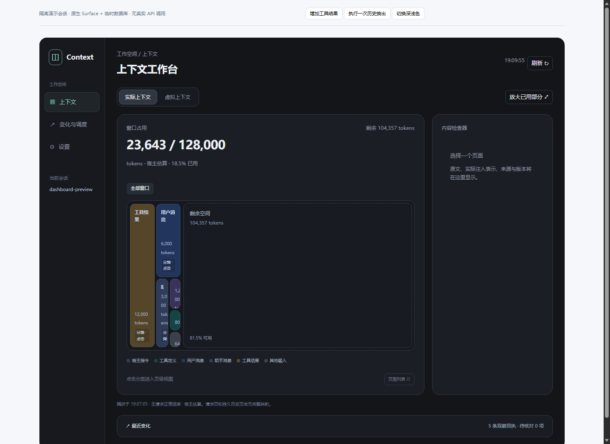

# 上下文工作台

这是 v0.18.0 重新实现的第一版 UI。旧看板主体、旧设置组件、旧操作组件和旧客户端组件测试已删除。宿主仍加载 `lib/client.js`，该文件由新源码构建。

## 窗口与页面

工作台采用三个主入口：上下文、变化与调度、设置。上下文使用单一圆角空间画布与右侧内容检查器，最近变化收在底部摘要条；窄容器中检查器变为可关闭的底部抽屉。

实际上下文先显示请求捕获时的宿主窗口估算：分类空间、已用量与剩余量。只有分类总量与容量口径可比较时绘制剩余空间。可切换完整窗口或放大已用部分。点击分类后，原画布切换成该分类的请求页图，并明确改用 JSON 字节计量；面包屑可返回总览。点击页面在检查器查看原文节选。请求页按用户消息开启的轮次组合，工具结果留在所属页。

请求目录最多128页，正文节选合计最多32768码点。超限内容仍计入总字节量。请求页以当前请求内位置标识，尚不能与所有持久历史页一一对应，因此变化标签明确写明按请求页位置比较。主请求的正常结束回执推进基准，失败和辅助调用不推进；它不是供应商费用证明。

虚拟上下文复用插件页面、归档历史、工具结果与已登记项目资源的权威目录。按来源字节切块，每屏20项；大小未知或为零的条目保留列表入口。矩形颜色表示已观察到的原文、引用、摘要或未知状态。目录引用的成功交付不等于正文已注入。摘要属于来源的派生表示，不重复画成原始页面。

“内容变更”比较正文哈希；默认基准为最近正常结束主请求所观察的目录来源版本，也可手动保存当前查看基准。来源不在完整基准中时才标记“新收入”，覆盖不完整时保留未知。进程重启后没有交付观察时不推断过去的注入状态。

点击页可在检查器读取固定版本原文、摘要表示与可用的历史版本。每次读取最多4096字符；历史来源可能记录访问计量，浏览不会换入页面。变化对比只有版本哈希时展示版本变化，不生成没有证据的文本差异。未登记文件、活动历史及有界扫描范围外的来源均保持覆盖未知。

## 参数与操作

- 展示偏好在宿主设置页，作用于当前浏览器，立即生效并自动保存；保存失败明确提示。
- 参数设置集中管理聊天预算、在线配额、水位、目录注入与自适应开关；提交前显示编辑值，当前配置另有只读详情。
- 命名空间工作页策略明确作用范围与下一次步骤检查的生效时间。
- 宿主挂载能力为只读状态，需要修改插件配置并重新加载。
- 调度与操作提供历史归档、工具结果外置/恢复、宿主摘要与插件工作页归档。
- 来源与恢复支持搜索、分页读取及带固定来源版本的笔记。
- 活动状态提供任务新建、显式进度更新及资源快照操作。
- 变化记录展示宿主回执；诊断展示计量、准入、供应商实际用量与覆盖范围。

未知提交结果不会自动重试；同一操作的显式重试复用请求身份。预算和水位写入以服务端校验为准。

## 源码与验收

`client/create-client.js` 负责宿主插槽；`dashboard.js` 组合三个入口；`runtime.js` 管理请求、偏好、查询与提交；`panels.js` 实现参数与操作；`workbench.js` 管理画布与读取状态；`canvas-view.js` 渲染同级画布与检查器；`tiles.js` 保证面积比例；`window-meter.js` 校验计量口径；`primitives.js` 与 `styles.js` 提供组件与隔离样式。

运行 `npm run build:client` 构建，`npm run check:client` 检查源码与产物一致。React 使用宿主实例。`npm run preview:dashboard` 启动本地隔离预览，使用合成内容、真实 SDK Surface 与临时数据库，没有供应商调用。

截图来自隔离预览，已检查宽屏、窄屏和参数页。正式宿主激活、真实供应商与正式发布仍按整个项目的发布边界另行验证。

2026-10-30 发布验证：完整 Node 回归346项通过；清理旧报表后 Python 回归279项通过。本次布局使用临时数据库与合成会话截图，覆盖完整窗口、虚拟页读取、双栏检查器和窄容器抽屉。所有截图由独立临时配置的无头 Edge 生成并人工查看。
