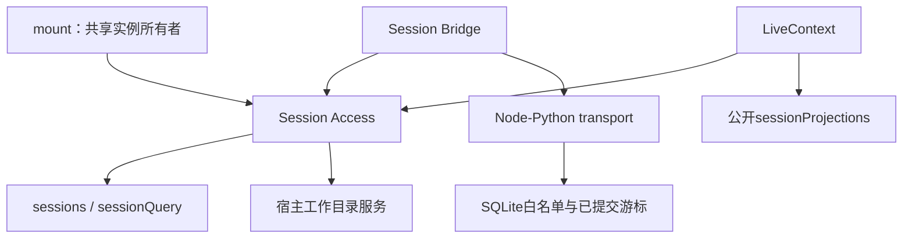

# 会话连接分块重构：A1

状态：开发分支已完成A1，本轮按用户安排暂不发布。
基线：v0.17.0；发行版本、正式插件和数据库未更新。

## 已完成的边界



mount创建一个共享Access，交给Bridge及入口装配的LiveContext。
独立创建这两个使用方时，会创建并拥有各自的Access；
注入实例的使用方只取消自己的工作，不关闭公共实例。

Access模块位于adapter/session，包含宿主能力读取、项目根、观察、冷准入和生命周期。
接口为capabilities、projectOf、withRead、withLiveCut与dispose。
完整契约在[skill接口参考](../../skills/dsh-session-access/references/contract.md)。

## 行为与兼容

- 活跃优先；排到冷队列队首及观察返回后重查活跃会话。
- 冷观察通过宿主公开查询与detached prepare，不激活Agent、不发模型请求、不修改日志。
- 一个Access最多同时执行一个冷观察，总容量32；取消等待项归还名额。
- 宿主忽略取消时外层及时退出，冷准入槽保持到实际观察完成；迟到lease释放且不进入回调。
- prefix允许新追加，exact要求切点相等；逐条连续性仍由Bridge校验。
- Bridge每批128条、每轮最多4个切片、32项待处理、128会话状态上限及边界重发保持。
- LiveCut提供组合signal与check；异步RPC返回后先检查，再推进本地游标。
- Fork/PTC/Surface替换归属、提交丢响应后的幂等恢复、旧resolveProjectRoot导出保留。
- 只读门面通过真实Session身份访问公开投影，保留宿主缓存；当前推导与实际主请求继续分开。
- dispose变为可等待排空，清理顺序为使用方、Access、transport。
- 新增及迁移的注释与文档字符串使用中文。

## 提交节点

1. `0b374d1`：访问层与独立契约测试。
2. `70e88dc`：Bridge/LiveContext共享接入、取消与队列边界、清理调用和兼容回归。
3. 中文维护skill、验证脚本、本进度记录与未发布更新说明。

## Skill交付

[技能入口](../../skills/dsh-session-access/SKILL.md)随仓库维护。
包含接口契约、生命周期与验证参考，以及显式接收--repo的verify.mjs。

```sh
node skills/dsh-session-access/scripts/verify.mjs --repo <仓库绝对路径>
```

脚本运行固定测试，不读取正式profile或数据库，不自动安装skill。
独立压缩包生成在忽略目录build/dsh-session-access.skill；运行时代码仍只存在于adapter/session。

## 本机验证

| 检查 | 结果 |
|---|---|
| 独立Access契约 | 20项通过 |
| 七组针对性回归 | 68项通过 |
| Skill固定专项脚本 | 76项通过，0失败，0跳过 |
| 全部Node/真实SDK | 280项通过，0失败，0跳过 |
| 全部Python | 223项通过 |
| skill-creator结构校验 | 通过 |
| doctor | 通过 |
| release metadata一致性 | v0.17.0通过；未升级发行版本 |

Node完整回归及skill脚本在允许临时localhost和junction的环境执行。
本轮没有推送、远端CI、合并、tag、GitHub Release、正式插件同步、浏览器点击或宿主重启验收。
本机通过不代表Linux CI或正式桌面验收已完成。

## 后续节点

| 节点 | 当前状态 | 范围 |
|---|---|---|
| A1 | 已完成 | Access与两个首批使用方 |
| A2 | 待实施 | Agent解析、宿主维护/flush适配，任务/快照/归档/结果投影逐个接入 |
| V1 | 待实施 | Session Views、公开投影、轻量head与按需detail |
| V2 | 待实施 | 客户端共享Store、变化通知和轮询兼容 |
| B1 | 待实施 | Bridge队列、白名单映射与replay进一步拆分 |

A2不得改变历史归档的空闲维护时机，或把结果投影的步骤边界改成嵌套runMaintenance。
后续每块分别交付对应skill。完成预期重构层后，再统一处理版本、两平台CI、发布与正式激活。
