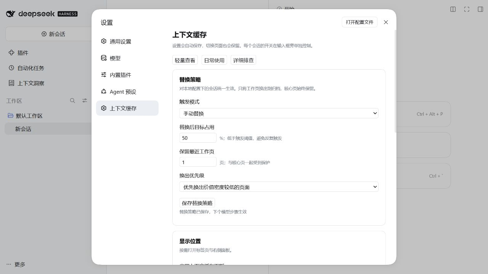

# 0.3.0 可用性审查与优化节点

日期：2026-10-21。基线：`0966067` / v0.2.0；工作分支：`codex/vcontext-kernel-030`。

## 审查范围与结论

检查 SQLite 事务/缓存/预算/持久化、Python 服务生命周期、Node 进程协议/取消/超时/排队、宿主工具与生命周期接入、HTTP 路由、看板状态与设置、日志、公开投影联动、版本元数据及发布流程。基线 28 项 Node 和 57 项 Python 测试通过，但缺少故障清理与缓存回滚覆盖；新增回归复现并修复了以下问题。

本插件适合本机单用户使用，页面缓存功能可以独立运行。可选 dsh-context 联动读取宿主公开投影；它不会接管上游插件、宿主压缩或模型完整上下文预算。

## 独立 Git 节点

| 节点 | 提交 | 问题与完成行为 | 验证 |
| --- | --- | --- | --- |
| O1 内核与生命周期 | `81ce86d` | 回滚后废弃缓存、热快照避免大文本读取、有界序列化缓存、线性换出队列、补齐服务关闭 | 缓存回滚复现、连接 LRU、关闭重入、请求超限恢复 |
| O2 RPC 稳定性 | `9fdfd68` | 限制排队/响应、处理 stdin 错误、隔离旧进程输出、取消写入终止、下一调用重启 | 故障注入、乱序响应、超时重启、读取取消、记账取消 |
| O3 结构化诊断 | `8e30a6c` | 请求编号、耗时、结果、会话摘要、有界诊断与健康路由 | 无正文/原始错误泄漏、日志接收方异常不影响调用 |
| O4 dsh-context 联动 | `6955f2d` | 公开投影适配、压力来源区分、用量/组成/诊断卡片，缺失时降级 | 原生 0.74.0 注册、上下文替换、卸载、token-meter 优先 |
| O5 可用性修复 | `e1cb96a` | 存储故障仍允许宿主继续、完整账本累计用量、同源请求约束 | 缺失 Python 故障、205 次调用小明细窗口、跨来源拒绝 |
| O6 自检与发布门禁 | `cf493f1` | doctor、版本一致性检查、CI 门禁、可操作错误分类 | 本地自检、版本检查和完整测试 |
| O7 版本与说明 | `v0.3.0` | Node/Python/锁文件/README/CHANGELOG 同步、安装审阅副本同步、GitHub Release | 发布前同名版本检查、打包检查、CI |

节点可以分别通过 `git show <提交>` 审阅。撤回应创建反向提交和新版本，不改写已发布标签。

## 验证证据

- Node.js 22.19.0 + SDK 0.2.0-rc.2：41 项测试通过，0 失败，0 跳过。
- Python 3.12.3：63 项测试通过。doctor 还识别并通过了本机 Harness 附带 Python 3.12.14。
- dsh-context：npm 官方包 0.74.0，对应上游提交 `77749653063ab282287583c3de02fa7da092c335`。通过 SDK 原生注册测试；仅依据公开契约实现适配，没有复制上游实现。
- 将本机现有 dsh-context 0.72.0 入口复制到隔离测试目录，使用测试 SDK 注册后，公开投影也返回 connected；没有改动该安装。
- GitHub PR #1 的 push / pull_request 两轮 Windows、Ubuntu CI 全部通过：[push](https://github.com/shaocuirong/dsh-vcontext/actions/runs/39582874251)、[PR](https://github.com/shaocuirong/dsh-vcontext/actions/runs/39582948710)。
- 本机已安装 Harness 0.2.1-rc.2：通过独立 DSH_HOME 的 web profile 加载两个插件，以演示数据创建 Agent；实际 `/vctx/dashboard` 返回 connected、组成数据与上游累计用量。浏览器检查创建前开关、侧栏、设置和策略保存；不触碰日常配置和数据库。
- 本轮没有供应商生成请求；不宣称真实模型效果、token 缩减或缓存命中改善。

本机 Harness 设置保存验证（隔离 profile、演示数据）：



```sh
npm ci --ignore-scripts
npm run doctor
npm run check:release
python -m unittest discover -s tests -v
npm test
npm run bench
npm pack --dry-run
```

本机小负载基准（ms，不是优化前后对比）：

| 路径 | p50 | p95 |
| --- | ---: | ---: |
| 常驻服务未变化快照 | 0.2 | 0.3 |
| 写入后变化快照 | 2.5 | 3.1 |
| recall | 4.9 | 9.3 |
| 逐调用解释器 render 对照 | 295.0 | 307.9 |

热快照回归另外通过 SQLite trace 检查命中路径只查询渲染元数据，不读取完整旧文本；不能将上述不同路径耗时解释成此次改动带来的倍数加速。

## 升级与保留边界

1. 完全退出 Harness（含托盘），更新链接仓库到 v0.3.0，再启动。链接安装直接读取仓库代码。
2. SQLite schema 仍为 6，没有重建或覆盖数据库；原配置保持兼容。
3. 如需联动，在同一 profile 安装 dsh-context@0.74.0，并将两个 bundle 一起启用。仅查看缓存页不需要上游依赖。
4. 服务不会自动重试失败写入；超时或取消后先读取状态。宿主步骤降级时使用上一次成功快照，直到后续读取恢复。
5. 诊断仅在内存保留最近记录；宿主 logger 负责持久化。需要更细日志时设置 logLevel=debug。

本机正式插件目录以 junction 指向当前项目，发布后同步项目源码即可同步正式副本。检查时日常 desktop profile 已启用 dsh-context 0.72.0，但尚未启用 dsh-virtual-context；本次保留日常启用列表，启用步骤见 README，不覆盖机器配置。

归档搜索仍会扫描该作用域的全部页面；看板仍读取页面元数据，因此海量归档需要后续基准与分页设计。RPC 上限保护进程内存，不代替查询索引。API 适用于本机单用户环境，同源检查不构成多租户认证。上游版本升级后应重新运行原生投影测试。
