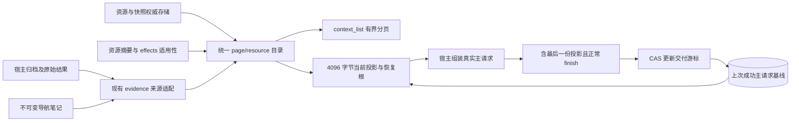

# C3 统一目录与交付基线：实际契约

本节点为来源适配、当前请求投影和接续增量，不是整个工作区的搜索引擎，也没有实施 C4 仲裁器或 C6 自动摘要生成。

## 数据流



`adapter/control/catalog.mjs` 适配来源；不再建立另一份正文或规范事件日志。旧 evidence_list/read/note 与看板保持兼容。生产 vctx_evidence 变量改为 vctx-context-directory-v1；旧 evidenceDirectory.outline 是兼容视图，不能当作生产投影验收。

## 来源与表示

| 来源 | kind / 逻辑身份 | 恢复 |
|---|---|---|
| 已归档历史 | page / 不可变 archive ref | evidence_read → history_read |
| 原始工具结果 | page / 事件绑定 result ref，正文是页成员 | evidence_read → result_read |
| 已登记资源 | resource / project、session、完整相对路径的指纹 | resource_read 固定 ref |
| evidence note | 不增加来源 kind；挂到直接或递归来源的 summary 表示 | evidence_read |
| summary_store 资源摘要 | 不增加来源 kind；保留精确资源 ref/hash 和适用性 | summary_read |

同正文的不同事件保留不同 ID。资源版本更新保持逻辑路径 ID，source_ref/内容指纹变化；当前资源改版不会把旧摘要移接为新版本摘要。目录不参与重新分段，归档 ref 保持原来源；活动宿主页计划仍由原 segmenter 管理，尚未迁移进统一目录。

来源权限为只读、允许提议表示；写资源、任务、摘要仍经各自显式 API。导航内容没有指令权限或测试等级。每来源最多携带8个表示，传递来源 ID 最多32项；超出和缺失来源链标记覆盖不全，原始摘要不删除。完整父表示覆盖的下层导航项不重复注入，固定原文仍从来源链恢复。

## 有界视图与覆盖

- 后端权威数据完整保留；单次适配最多256归档、100结果、100笔记、128当前资源。registered-resources 只表示已登记资源，不代表磁盘全集。
- resource 深分页通过 context_list(kind=resource,offset,limit) 查询，可超过注入扫描范围。历史扫描仍有原上限，明确回报覆盖；恢复根保留 evidence_list 以查询原笔记。
- 资源摘要元数据取最近8条，每条最多8个直接来源；超限明确不完整。不是完整摘要历史列表，已知 summary_id 继续可读。
- 目录占用独立于任务状态：默认4096 UTF-8字节、8个目录条目（含两个恢复根），delta 最多4项。根→模块→叶按预算展示；折叠不修改后端。
- 项目资源根和历史根始终保留，模块折叠只提示范围，深分页取回叶条目。预算失败只使目录 unavailable，不覆盖任务状态。
- freshness 消费 C2 effects 观察水位；落后为 unknown，pending/stale 保留。只读列目录不进行现场读盘，也不把“没看到写入”标 fresh。pinned 资源始终是固定历史。

## 内容版本、表示与交付

目录 version 是当前有界来源的规范化指纹，含内容修订、适用性和摘要表示；不使用每步时间戳或全局 seq 作为统一内容版本。来源自己的 git/snapshot/host 描述保留，原始哈希与当前适用性分开。

`vcd_schema1/vcd_delivery` 只存有界来源版本清单和交付 generation；不复制目录正文。已有 schema9 首次加扩展前创建非覆盖 pre-catalog1 备份，未来 schema 拒绝降级。正式数据库不作为夹具。

- prepare/read/list 纯读；刷新、预览和辅助模型调用不推进持久基线。
- 当前实现 consumer=main；按 namespace/session 分区，目标作用域包含项目及 working/pinned 快照。
- 核对真实主请求的最后一份目录投影，字节须等于准备值。宿主当前将运行时上下文放在 user 消息；旧历史中的投影不能冒充最后一份。
- 只有 stop/tool-calls/max-tokens 正常 finish、且未取消时提交；失败、未消费流不提交。模型是否理解没有数据，不作推断。
- CAS 防止陈旧请求覆盖新游标；失败仅失去新基线，后续从旧基线再给概览/增量。跨消费者或并行主请求的高级合并尚未实施。
- 同目录内容版本保留投影字节，已交付回执不触发空 delta 或新宿主快照。此时重复出现的 delta 仍保留最初基线；它不是新变更通知。

delta 包含 base/target、变化 ID、路径/固定 ref 与覆盖信号。工作树内容只引用实际保存快照；没有 commit 的不制造提交引用。退出扫描窗口记 left_view，不能推断源删除。没有基线/切换目标时给有界概览；链不全明确 coverage=false。预算折叠和 delta 截断不等于全部叶条目已被模型读取，进一步细节经恢复根查询。修改原因没有证据时不生成语义解释。

## 调用与验收

```json
{"operation":"context_list","input":{"kind":"resource","offset":128,"limit":20}}
```

catalog_resources/baseline/delivered 是宿主内部 RPC，vctx 工具不能调用；context_list 是只读适配入口。传输读写分类与 Python 保持一致。

catalog profile 验证统一身份、层级预算、恢复、持久 CAS、真实离线主请求、失败/取消/辅助调用、任务与快照兼容。Python test_catalog 验证元数据不带正文、来源版本、观察落后、迁移备份与未来 schema。完整结果见 progress.md。
