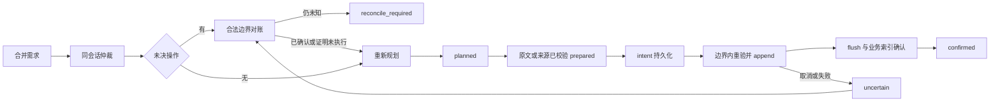

# C4 统一协调与提交恢复：实际契约

`mount` 创建一个 `createControlCoordinator`，index 将同一实例交给历史、结果、压缩和自动整理。候选与来源校验保留在纯 planner 和专属执行器，协调器拥有触发、同会话仲裁、后台轮转及未决屏障。它不是跨进程锁或跨宿主/SQLite 原子事务。

## 所有权与迁移

| 旧入口 | C4 所有者 | 保留的业务边界 |
|---|---|---|
| automation 的 idle/status/step 订阅、定时器、重入状态 | coordinator | 一批最多8历史页/256KiB；L2原有8项事务批次 |
| result-projection 的 pre-step 订阅 | coordinator 的 step worker | admitted pre-step 中应用，拒绝时不应用，不嵌套维护 |
| pageOut/archive | coordinator.execute + 原 history executor | runMaintenance 内重验、append、flush、marker |
| 原生 compact | coordinator.execute + shared Access | 宿主 compaction 自己决定来源与摘要；不代替精细换页 |
| 模型驻留/配额、宿主 quota/replace | coordinator.local | 内核短事务与原保护/容量守卫 |
| 自动 L2 tick | coordinator.tick → control_tick | 操作和确认回执在同一个 SQLite 事务 |

`SessionAccess.withWrite` 默认仍是 host_compact。新增 capability=session_mutation 不要求 compaction 服务；activate=false + 已有 agent 用于自动路径，不调用 resolveAgent 激活冷会话。精细句柄不能 compact。grant 是追踪身份，不是权限系统，也没有自动提供宿主幂等。

单独构造兼容 helper 时，history/result/replacement 不传 coordinator 仍保留旧行为；不能把这些单独实例当作统一仲裁。生产 index/mount 共用实例，不能另建 Access 或协调器绕过冲突。

## 需求与调度

- 每会话一项写，最多64个并行写会话；宿主写冲突明确 BUSY，不积压旧来源计划。
- 后台最多保留128个会话状态，全挂载同时处理一个后台批次，批次后让出事件循环再轮转。自动只使用已知活跃 agent。
- 重复 schedule 共用当前 promise。执行期间新边界或配置需求保留为 dirty，完成后重新计算；配置变更等待旧批次后重新调度，不吞掉变化。
- 前台驻留/容量写只等待已开始的短后台内核事务；不等待另一项宿主写。固定证据读取不持写门。
- 成功但仍有容量压力的有界批次沿用30秒续批；错误指数退避最多300秒。protected、NO_GAIN 不自行忙轮询；未决屏障不自动反复执行。
- 自动运行先同步只读元数据，再对账，之后才做 L2 tick 和压力动作。未知测量不启用相应自动动作。
- 共享 control-policy.json 定义动作与边界，新增 archive_history；Node 协调器与 Python 账本读取同一份定义，调用者不能把 project_result 改成 idle。

## 提交流程



`vcc_schema1/vcc_operations` 按 namespace/session/request_id 保存 action、不可变 descriptor、阶段 detail 和结果；没有正文、完整工具参数或会话 handle。每条最多120000序列化字节，未决最多32项，不因 TTL 或终态清理而过期。保留最近128项操作的终态回执，这是有界重放窗口，不承诺无限幂等。

control_status 的 pending 返回全部未决最小身份；recent 受完整响应预算裁剪，并标 recent_truncated。control_read 按精确 request_id 读一条。read/status 不改变状态。

control_tick 重放结果保留紧凑原因、策略及任务修订，完整 protection_basis 仍从 auto_preview 读取；页明细过大时带 pages_total/pages_truncated。不能因256个保护页反复展开解释而使原子 tick/回执溢出。

planned/prepared 没有 intent，可证明本协议未开始宿主写；恢复为 not_applied。intent/uncertain 必须由专属恢复器证明效果或未执行，不能仅凭取消、超时、预留到期或错误码作回滚结论。

Access 外层可能提前取消。协调器保留实际执行回调/原生压缩 promise，在其停止前不释放自己的操作名额；仍有不确定写时通过持久屏障阻止新写。服务身份或 signal 改变后，异步返回须再次 check，不能用旧观察继续 append。

## 各提交域如何恢复

| 动作 | Intent 中的依据 | 恢复依据 |
|---|---|---|
| 历史整页/整段归档 | 原 seq 集合、before_seq、page_id/keep_turns、request_id | 全日志内本会话 owned marker；只重 flush，不再次 append |
| 结果引用/恢复原文 | 固定 ref、原始 seq、期望状态、旧 Surface seq、计划 revision | 原始对象校验和单来源替换链；确认可见状态，重 flush/mark/finish |
| 原生压缩 | request_id、写前计量 | 不具备 request_id marker，未知结果保持屏障，不能自动重 compact |
| 自动 L2 | request_id、auto_tick 描述 | control_tick 与原自动整理事务一并提交；同 ID 重放原结果 |

原生压缩成功回执仅保存 shadowed_items/shadowedTokenCount，不复制宿主返回的摘要正文或大型来源数组；公开压缩任务仍报告准确条数及前后计量。

历史恢复若没有 marker 且原始来源仍在 Surface，可判 not_applied；其他情况保持 unknown。结果恢复在 pre-step 直接对账；idle 时经维护入口对账。两种情况下恢复器都不 append 新投影。手动新计划会先重验当前计划 revision，避免旧 queued 列表覆盖新意图。

confirmed 早于响应丢失时，重试读取持久结果；确认回执失败则保留 intent/uncertain，或读回已经 confirmed 的结果。原结果计划在未知时保持 queued，不能提前标 failed 而丢失恢复入口。旧 auto_receipt 保留兼容审计与旧版未决 marker 恢复，不再拥有独立调度订阅或计时器。

## 人工复核与接口

模型拒绝 control_ 前缀。宿主同源本机入口：

```text
GET /vctx/control?session=<id>
POST /vctx/control
{"session":"s","request_id":"操作ID","state":"confirmed","note":"人工核对宿主日志的依据"}
```

POST 只修改未决回执，不执行宿主动作、不提升测试等级。confirmed 人工复核仅用于 host_compact；其他动作不能凭一段说明伪造精细业务成功回执。not_applied 可在人工确认后结束未决记录。记录 host_review.origin=human 与说明，区别于程序确认。没有人工依据时保持未决，不自动调用此入口。

自动面板 inspect 包含 coordination；scope 内未知操作会阻止后续写。C4 尚不阻断主模型请求本身，硬预算准入属于 C5，不能把写屏障称为请求拦截。

首次扩展旧 schema9 前创建非覆盖 pre-control1 备份，主 schema 保持9，未来 vcc schema 拒绝。正式数据库不用于迁移测试。回退前停止触发并对账未决；不能简单换旧路由继续写。

## 验收范围

coordinator profile 覆盖共享写门、同会话冲突、后台轮转、丢失边界需求、服务替换、取消后迟到返回、marker/结果投影重启恢复、确认回执丢 ACK、原生压缩不盲重跑、合法 pre-step 和同源人工入口。

Python test_control_commit 覆盖阶段转换、descriptor 冲突、终态不可改、未决不清理、响应预算、命名空间隔离、L2 原子回滚及备份/未来 schema。完整执行结果见 progress.md；真实模型、远端CI和正式宿主激活另行验收。
