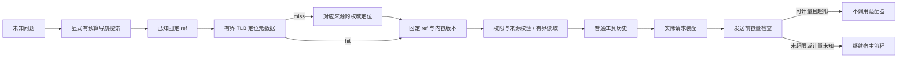

# C5 固定引用恢复、读取预算与请求准入：实际契约

## 已实施的链路



`adapter/control/resolver.mjs` 只管理定位元数据与读取预算。`vcontext/retrieval.py` 从原有页面修订、资源、摘要和笔记存储读取，不新建来源表或另一套索引。历史/结果仍归原宿主和结果存储权威管理。

## 引用与 TLB

| 固定来源 | 形式 | 解析权威 |
|---|---|---|
| 项目资源 | vctx://resource/32位ID | 原资源元数据，仍校验当前项目读取权限 |
| 页面修订 | vctx://page/32位ID/正整数版本 | 本会话页面与不可变修订 |
| 资源摘要 | vctx://summary/32位ID | 本会话摘要元数据 |
| 导航笔记 | vctx://evidence/32位ID | 本会话不可变 note |
| 历史归档 | vctx://history/16位owner/seq | owned archive marker |
| 原始结果 | vctx://result/32位ID | 原结果完整性验证 |

同文不同页保留不同 ID；缓存不会按正文哈希合并来源。旧 `read(page_id,version?)` 可按当前页或指定修订读，返回 source_ref 后可固定续读。

定位仍沿用 kind=page/resource，source_type 只负责选择历史/结果/摘要等权威适配器，form 独立说明原文或摘要。摘要不是第三类目录来源；规范摘要读取保留 not_tested 和 C2 currentness，固定版本不能冒称当前有效。

定位中的 form 描述被定位的表示，不能据此推断正文已经驻留；TLB 本身只保留引用元数据。

- key 包含会话身份、宿主 Session 对象、cwd、fs/query/sessions 服务身份及后端对象/配置/进程代次。相同 commit 的不同工作树不共用定位。
- 缓存只允许 ref/kind/source_version/大小/读取入口等标量；不存正文、摘录、来源数组、路径别名、新鲜度或宿主句柄。
- 最多256项，key 与 value 的序列化 UTF-8 总量最多128KiB，单项最多4KiB；超大定位不缓存，读取仍可继续。这是元数据配额，不是 JS 堆内存精确计量。
- 固定来源不因无关新 seq 或任务/目标变化全清；可变 path 每次经原目标和 C2 现场逻辑解析，不能把旧 path 映射当作当前许可。
- 后端重启代次、服务或 scope 改变后使用新 key；读取返回期间变化拒绝旧结果并撤销相应定位。缓存命中不替代权限和正文完整性检查。
- 不缓存失败。已知 ref 的 miss 只查该权威，不暗中改成语义搜索；未知问题才显式 context_find。

进程代次用于常驻 Service；process 模式的独立解释器仍共用已绑定的存储身份。完整性检查可能扫描原对象，输出配额不等于源扫描字节或 CPU 配额。

## 读取预算与兼容

共享 control-policy.json 定义默认值：正常响应 value 最多64KiB，每个真实 step 的正常证据响应合计最多128KiB。并发读取先预留额度，完成后按实际完整 JSON 计量；异常释放预留。后端重启不重置同一步骤额度。

`read`、resource_read(ref/path)、summary_read、result_read、history_read、evidence_read 经过统一读取额度；context_read/expand 也计入。读取不自动 page_in。搜索与目录沿用各自的有界导航覆盖，不把它们宣称为正文读取。

每步额度用于带执行主体的 vctx 模型工具。看板浏览和裸宿主 RPC 不伪造模型 step，也不消耗该额度，继续遵守各自单响应边界；底层资源 RPC 的完整响应上限为128KiB。

额度不足返回 incomplete/reason/continuation/residency_changed=false。限额提示只回传有界选择器，不复制任意原始参数；普通响应额度不包含后续提示和宿主工具框架开销，notice_bytes 单独计量。最终实际请求守卫会计量它们形成的宿主输入，因此不能仅凭读取额度推断请求一定可容纳。

资源底层 RPC 同时限制完整 JSON UTF-8字节与码点，保留512字节传输封套余量。offset/limit/next_offset 按 Unicode 码点，不切开 emoji 或转义字符。默认字符上限仍为65536，但字节或包装先达到上限时提前分页；不能再假设每页固定65536字符。原始内容和 hash 不改变。

resource_read(path) 继续返回已保存版本及 C2 currentness；多页续读应固定 resource.ref。read 返回 source_ref，摘要可用 summary ID 构成固定 ref。legacy 返回字段保留，必要时增加分页字段或预算提示；source_read 的规范文本入口不复制整份来源数据进入 IPC。

## 来源展开

context_expand 仅展开 note/summary 的来源边。默认16节点、深度3，参数最多32节点/3层；实际节点数还受本次响应额度限制。每个来源页最多8条边，剩余用 `{ref,offset}` 继续；不会为了“展开”自动读正文或永久驻留。

结果包含 nodes/edges/continuation/incomplete。edge.source_version 是记录的精确来源版本，version_match=true 只表示该固定引用版本匹配；null 表示尚未展开，false 表示版本不符。它不是事实、摘要质量或测试验证。缺链/限额保持 incomplete，不按起止 seq 猜覆盖。

## 两个准入边界

| 边界 | 实际检查 | 限制 |
|---|---|---|
| page_in/recall/restore 等显式 L2 动作 | 原短事务内检查 session/project 在线配额及保护，失败回滚 | L2估算不是供应商请求tokens |
| 结果正文恢复前 | detached Session 候选，公开投影计量恢复后输入 | 依据最近 request/context；不是下一条路由的授权租约 |
| 主请求 llm/stream | 实际消息/工具仍匹配被计量 Surface；当前准确 provider/model 路由容量减输出预留 | 只在可用、未失效的宿主估算下执行 |

恢复候选用公共 Session.fromRestore 构造同 ID 的 detached 副本，不进入 Store，不注册 Agent、不发模型请求、不 flush 真实日志。先验证副本当前可见前缀与原 Session 等价；缺少自定义纯投影能力时明确 unavailable。候选超限在 intent/append 前拒绝，原引用和正文都保留；控制回执及失败结果保存 capacity 缺口。

恢复预览携带 basis=last_request_context/basis_seq。pre-step 后若路由变化，以发送前的实际请求检查为准；不能把旧预览当作新模型窗口的许可。

发送前只处理 isAgentLoopRequest；辅助压缩/标题调用不使用主请求预算、不覆盖主请求观测。实际消息与工具、最新投影 as_of_seq 和准确路由必须一致，才能作容量结论。超限在调用 next/适配器之前抛 VCTX_REQUEST_CAPACITY，不走宿主自动压缩兜底。原始用户/工具证据仍留在日志。

reason 为 protected_capacity 或 request_capacity，并返回估算 used/budget/gap/model_window/output_reserve。protected_tokens 目前仅是宿主 system+tools 的可见下界；缺失为null，不编造为0，不宣称包含全部活动状态。

**计量精度与降级**：unit=estimated_tokens，source 来自公开 dsh-context/token-meter 投影，provider_token_guarantee=false。实际准确路由窗口来自宿主 request/context；估算不是供应商 tokenizer/计费实测。测量缺失、过期、请求视图不匹配或预览不等价时返回 available=false/enforced=false 并继续原流程，不冒称已拦截或保证可容纳。显式输出预留本身超限会拒绝；预留未知时，已经超过整个窗口的输入仍可拒绝。

requestAdmission 默认为启用，可由宿主配置 false；contextIntegration=false 同样使计量不可用。模型不能修改这些宿主配置。context_status/admission 是最近一次主请求观测，含 as_of_seq，不是当前请求的永久准入凭据。

## 模型接口

```json
{"operation":"context_resolve","input":{"ref":"vctx://resource/32位ID"}}
{"operation":"context_read","input":{"ref":"固定ref","offset":0,"limit":4096,"expected_source_version":"sha256:..."}}
{"operation":"context_expand","input":{"ref":"摘要ref","offset":0,"max_nodes":16,"max_depth":3}}
{"operation":"context_find","input":{"query":"历史决定","offset":0,"limit":5}}
{"operation":"context_status","input":{}}
```

context_find 仅覆盖原证据目录的有界历史/结果/笔记扫描，不代表全仓库文本搜索。项目资源导航继续用 context_list(kind=resource)。source_resolve/read/links 是宿主 RPC，vctx 拒绝 source_ 前缀。

本节点不新增数据库 schema，不安装全局 skill，不发布或改正式数据库。resolver/scheduler profile 和完整结果见 progress.md；真实供应商 token、费用、远端CI、UI及正式激活另行验收。

C6a 新增固定 event/stage ref 接入同一解析/读取额度。event 是原始公开页成员视图，不是宿主配置读取入口；具体白名单、版本和证明边界见 [native-evidence.md](native-evidence.md)。
