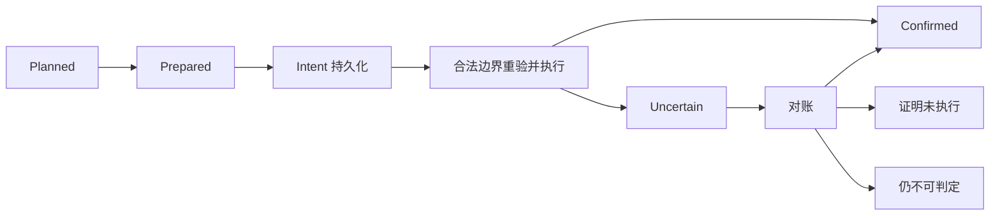

# 调度、生命周期与提交

C4 的实际接口、迁移范围与恢复限制见 [coordinator.md](coordinator.md)。本文包含后续 C5/C6/C7 的目标顺序，不能全部当作已实现。

## 1. 协调器与边界

一个会话协调状态合并需求，纯 planner 选动作，执行器拥有提交。Node 协调宿主；Python 在短事务内重验本地配额和保护，不无条件执行旧计划。

| 事件 | 即时行为 | 执行边界 |
|---|---|---|
| 工具开始/结束 | 记录可能效果、失效当前描述，包括失败部分写入 | 元数据；随后安全边界 |
| step/end | 幂等推进步骤水位，合并需求 | pre-step/idle |
| admitted pre-step | 当前视图检查、结果投影 | 不嵌套维护 |
| idle | 封口页换出、未决操作对账 | 宿主维护 |
| task/target 变化 | 更新依赖与适用性 | 下次装配前 |
| 明确读取/恢复 | 定位和容量准入 | 读取或动作所需写边界 |
| 阶段完成 | 摘要候选 | 后台生成，重验提交 |
| 服务/配置变化 | 取消旧能力计划 | 重新规划 |

自动整理不通过 resolveAgent 唤醒冷会话。显式操作可沿用宿主激活路径。

同会话一项可见写；挂载共享 Access，旧执行器逐步加入仲裁。BUSY 保留需求等待边界，不忙轮询或私建 Access 绕过。协调器合并事件，不积压固定旧来源的写计划。

跨会话轮转后台工作并限制连续批次；前台读不被长摘要挡住。未获授权不驱逐其他活跃会话满足项目配额。

## 2. 每轮顺序

1. 对账可能已提交的操作；固定证据读可独立进行。
2. 消费失效信号，撤销过期的“当前有效”声明。
3. 保证活动状态与最小恢复入口。
4. 满足显式读取/恢复/准入，检查加入后预算。
5. 处理容量压力。
6. 后台阶段摘要、索引重建及可取消预取。

候选先检查所有权、配对闭包、动作权限、必要版本/适用性，再检查保护和预算。推荐与执行共享语义，执行时重验。

压力动作优先：退出不适用投影 → 折叠目录 → 使用已有紧凑表示 → 保存大结果后引用投影 → 封口页换出 → 插件驻留调整 → 合适边界生成新摘要。当前边界不能执行则推迟，不套另一种锁。

同类排序：已完成且非活动路径、较久未访问、较低恢复代价、对受压预算净释放较大、稳定 ID。无校准依据前不引入综合权重。

## 3. 预算与防抖

分别观测 request_input、directory_view、injection、online_session/project、retrieval、maintenance；保留单位、来源、新鲜度。L2 驱逐不等于宿主输入减少。

请求工作预算沿用 min(配置预算, 模型窗口 - 输出预留)。初期各容量维度保留 85%/70% 高低水位；前台准入始终检查硬上限。未知测量只禁用依赖它的自动动作，不禁用固定引用读。

兼容节点保留：历史批次 8 页/256 KiB；结果投影 2 项、合计及单项原文上限 8 MiB；目录初值 8 项/4096 字节。目录超限逐级折叠保留恢复根。这些是兼容初值，不是优化效果结论。

每次可见写后重测。一次确认无净释放就停同版本路径；缺测量记 unknown。保护导致无法达到目标时返回缺口，不自动解除保护。

相关版本不变时 protected/no_gain 不定时重试。计时器只用于有界退避、续批与降级重验；任务、来源、配置、解除保护或前台需求变化可唤醒。

## 4. 摘要与稳定表示

同一阶段/来源版本最多一项生成任务。生成和评审在精细写租约及数据库事务之外；产出草稿，提交前重验来源、任务、覆盖和预算。

活动状态、阶段摘要、可复用经验分别管理；局部 delta 更新，不反复重写全部历史。模型完成声明不替代任务或测试状态。

表示绑定来源和必要配置，压力变化本身不引起原文/引用来回切换。来源变化、显式恢复和相关功能开关变化释放对应稳定表示。

host_compact 采用宿主策略，不接收选定页集合；保护兼容性独立验证，不作默认失败兜底。

## 5. 提交协议

Prepared：原文保存/校验或摘要草稿就绪，必要额度预留。Intent 早于可见修改。明确尚未执行的拒绝/取消/变化可结束为 not_applied/stale；可能已执行则 uncertain。

精细宿主操作：仲裁 → 正确维护/步骤边界 → 重验来源/保护/预算 → 同步 append → flush → 核对效果 → 回执。

SQLite 在短事务重验后提交，不能包住宿主网络/模型等待。跨宿主和 SQLite 不宣称原子或天然 exactly-once。

换页使用日志 marker request_id 对账，重试先找效果。当前 grant.requestId 未传入 compactNow，不提供压缩幂等；压缩丢响应不得自动重跑。

取消不是回滚证明。可能已执行时留下可恢复未决记录。预留 TTL 不是未执行证明，不能据此静默释放未决容量。

lease、原始事件、host handle 不放长期缓存。异步返回后检查组合 signal/服务身份，不持有 LiveCut 等模型生成。

## 6. 查询与停止

已知 ref → 有界解析缓存 → 权威目录慢路径 → 来源校验 → 有界读取。
未知 ref → 有预算搜索 → 固定 ref → 前述路径。

TLB 类缓存只存定位元数据；miss 不用语义搜索替换已知 ref。key 含作用域、来源及必要版本；不因新消息全清。

read 不自动永久驻留，restore/admit 单独检查容量。来源展开超限返回 incomplete 和继续定位。

停止状态：reached_target、below_high、deferred_boundary、stale_plan、pressure_unavailable、protected_capacity、no_gain、reconcile_required、capability_unavailable。在 C0 确认并映射旧协议，避免各模块另建词表。

统计实际释放、压力来源、目录占比、解析 miss、证据恢复、失效延迟和对账。解析命中、驻留命中、供应商 KV 命中分开。

保护内容超过模型实际上限时，在支持的准入 seam 阻止请求并给出缺口。没有相应 seam 时明确限制，日志告警不冒称已阻止。

