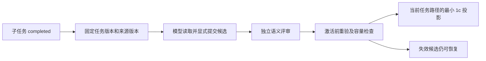

# C6a 实际契约：显式阶段摘要

当前支持已登记的固定资源、插件历史页及原生历史/native/PTC 证据证明。后者通过追加证明接入，不回写旧候选；详见[原生证据契约](native-evidence.md)。没有后台模型调用，也没有借用宿主 compact 生成定制摘要；真实模型质量与费用对照尚未验证。

## 流程与边界



`task_update/attach` 经 ContextStore dispatch 完成时，在同一事务捕获 basis。每个 namespace/session/task/version 只生成一个 basis；先取出 basis，模型在事务外生成，再显式提交，生成期间不持租约。旧库已有 completed 任务通过 stage_prepare 捕获时标记 `explicit_current_snapshot`，不伪称完成当时的版本。容量耗尽不阻止任务完成，但 stage_prepare 会明确报错。

来源为任务显式关联的 resource refs 和 page ids。page id 在完成边界解析成带修订号的固定 ref。相同内容的不同来源身份仍分别保留。工具自身的 vctx 管理操作不构成阶段工作证据；其他 operation 和 history seq 在宿主证明前分别产生 `NATIVE_OPERATION_REQUIRES_PROOF/NATIVE_HISTORY_REQUIRES_PROOF`，stage_prepare 补齐宿主证明后方可使用。来源超限、无来源、basis 字节超限均为缺口，不能靠语义评审覆盖。

`registered_task_sources` 只表示本任务已登记的来源集合，没有承诺所有宿主历史、磁盘或语义事实都已覆盖。模型语义遗漏需要评审，程序只能检查引用身份、版本、精确文本和结构约束。

## 接口

| 操作 | 输入 | 行为 |
|---|---|---|
| stage_prepare | task_ref | 返回唯一 basis、来源短 id、覆盖缺口和适用性 |
| stage_propose | request_id,basis_ref,capsule | 保存不可变候选，迟到候选也保留；不自动注入 |
| stage_review | request_id,ref,outcome,checks,explanation | outcome 为 pass/revise；只能记录 model 语义评审 |
| stage_activate | request_id,ref,expected_revision | revision 来自 stage_context；重验后显式激活 |
| stage_context | 无 | 当前激活 revision、适用性和最多一份 current_stage |
| stage_read | ref | 恢复候选、basis、最新评审和当前适用性；模型入口计入读取额度 |
| stage_list | offset,limit | 有界候选清单，最大16项；不注入正文 |
| context_read/expand | stage ref | 沿用 C5 额度，分页读 capsule / 展开固定原始来源 |

propose/review/activate 复用原有请求账本，重试需相同 request_id 与相同输入；参数不同拒绝。激活使用独立 revision CAS。第一次拒绝激活的 request_id 也保留原结果；修改状态后重试需新 request_id。

候选 ref 为 `vctx://stage/<32hex>`，是派生表示，不新增第三类来源节点。只读定位可缓存不可变 hash，当前适用性每次恢复时重新计算。未激活且已评审的摘要可进入现有 page/resource 条目的可调度表示；草稿不会自动进入目录。目录的历史恢复根提供 stage_list，未扫描到的来源或超过8条的表示链明确不完整。

### capsule 示例

```json
{
  "brief": "已修复本阶段的读取路径",
  "decisions": ["保留固定来源供复查"],
  "constraints": ["保持 ERR_42 原文"],
  "next_action": "检查下一个子目标",
  "unresolved": ["两份来源对结果的描述冲突"],
  "anchors": [{"source_id":"s1","offset":0,"text":"ERR_42"}],
  "contradictions": [{"text":"来源 A 与 B 结论不同","source_ids":["s1","s2"]}]
}
```

所有字段必填；anchor offset 是原始正文的 Unicode 码点偏移。程序比较固定版本的精确片段，不允许改写错误码或标识符；这不能证明模型已列出所有重要标识符。矛盾项至少关联两个不同来源 id，完整来源均保留，不做相似去重。

checks 必须完整包含 goals/decisions/constraints/unresolved/contradictions 五个布尔值；pass 要求全部 true，explanation 非空。origin 不接受调用者指定，不能自报 human/host。语义评审仍是 `verification=not_tested`，不影响 task_review 或测试状态。新的评审会撤销既有激活的评审依据，即使再次 pass，也必须重新显式激活。

## 适用性、保护与预算

激活前和每次装配都检查：任务版本/哈希、已关联证据集合、项目/root/target、固定来源版本、working 指针或 pinned 清单，以及效果游标/写版本和当前任务路径。完成子任务以父任务作为适用路径锚点；完成根任务须在其 fork 后续路径使用。焦点为空或转到无关任务时移除当前投影，返回原路径且依据仍有效时可恢复同一投影。源任务更新、关联变动或来源前进后，旧候选只作历史恢复。

首批写信号采用保守失效：任何新写版本或 pending 写都会使旧 basis 不适用，尚未按路径排除无关写；普通 host seq 增长不会单独触发失效。效果观察落后时不能激活。即使没有发现写入也仍标 `freshness=unknown/filesystem_verified=false`，不承诺外部磁盘未改变。固定来源的历史原文不会因此失效或删除。

- 每会话最多1024份 basis，每份最多64条来源、32,000 UTF-8字节；超限保留显式缺口。
- 每 basis 最多16个候选，每候选最多16次评审；都是不可变追加，不重写整个历史。
- capsule 最多8192字节；brief 320码点；decisions/constraints/unresolved 各8条、每条256码点；next_action 256码点；anchors 8条、每段160码点；contradictions 4条。
- current_stage 完整封套最多1536字节，保留决定、约束、下一步、未决、错误片段与矛盾字段；超限拒绝激活，不静默裁剪。所有完整内容经恢复入口仍可查。
- 当前投影属于目录现有4KiB总预算，普通叶项/delta 先裁剪；不会把已激活投影作为普通候选换出。只驻留当前一份，其余已评审摘要继续按目录预算调度。

这些只是本地字节和读取预算，不代表供应商 token、KV 命中、费用或摘要质量收益。

## 存储与迁移

独立 `vsm_schema1`，主 schema9 不变。bases/candidates/reviews 是摘要表示账本，只有原始来源 ref/hash 和派生内容，没有第二份源目录或原文副本。SQLite trigger 禁止改写历史；active 是可更新指针及 CAS revision，并绑定当次评审 ref。首次扩展前建立非覆盖 `.pre-stages1-<uuid>.bak`；未来 schema 拒绝打开。本轮仅临时库验证，不修改正式数据库。

| 旧路径 | 本节点 | 保留 |
|---|---|---|
| task_update/attach | 完成时附加 basis 捕获 | 原任务协议、验证与焦点规则 |
| summary_store / evidence_note | 继续原流程 | 不将未评审 stage 草稿塞入自动注入笔记 |
| context directory | 附加 current_stage 和 stage 表示 | page/resource 两类、原目录额度和成功交付基线 |
| context_read/expand | 接入固定 stage ref | C5 读取额度、原文恢复与不自动驻留 |

## 研究依据与后续

[ACE v3](https://arxiv.org/html/2510.04618v3) 的局部条目增量和确定性合并用于避免全历史反复改写；[MAGE v2](https://arxiv.org/html/2606.06090v2) 的已完成子目标边界与语义检查用于组织候选。这里的确定性门禁是工程实现，不能当作论文结论或形式证明。

原生事件/工具来源证明已接入，仍只承诺已登记来源；C6b 只有在能力、预算、取消及权限契约核实后才考虑独立生成器。真实模型的错误回忆、语义遗漏、任务成功率及总费用对照仍未验证，C7 尚未实施。
