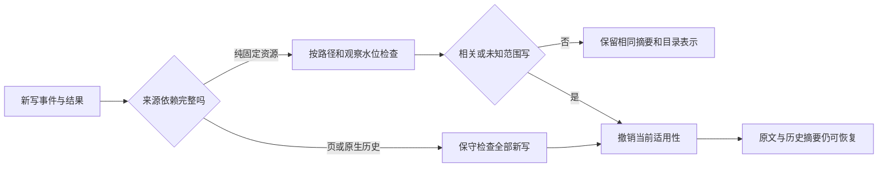

# C7 实际契约：依赖失效、运行观测与有界调优

本节点完成当前上下文控制重构计划的必要程序工作。C0–C7 已有本地实现及离线验收，不能据此称真实模型质量、供应商费用、远端CI或正式宿主启用已验证。可选 C6b 后台生成器继续关闭；没有新增模型调用、语义聚类、图数据库或服务端 KV 管理。

## 一、按依赖失效



StageState 与 EffectsState 共享写集查询。纯资源依赖只受相关路径或未知写集影响；Windows drive/UNC 根按不区分大小写比较。pending、失败后部分写入和未知范围仍保守处理。一次查询最多512条写记录，超限为 WRITE_SCAN_LIMIT/unknown，不能推断无变更。没有放宽宿主观察游标落后的门禁。

固定 pinned 目标的纯资源摘要依赖清单中相同固定版本，当前工作树写入不使其失效；换目标、任务或来源版本仍须重验。插件页和原生事件没有完整文件依赖时，继续使用全写集失效，不能仅凭工具叙述推断完整路径集合。

有现场观察的 working 资源如果已经 stale/pending/unknown，重新生成 task basis 不能掩盖它，返回 SOURCE_RECHECK_REQUIRED。只有通过宿主 effects_observe 的同 hash 现场核验才能覆盖已检查水位之前的写；它允许保持原候选，不需要重写摘要。变更 hash、未确认写和外部未观察状态不冒称 fresh。调用者自行 resource_store 的固定文本只是保存快照，不获得现场证明。

## 二、有界运行观测

`context_status({})` 新增 control 字段，包含：

| 指标 | 实际含义 |
|---|---|
| prepared / latch_hits / delivered | 目录装配、同内容版本复用、成功主请求交付 CAS |
| directory_bytes / index_bytes | 当前完整目录字节 / 扣除当前阶段正文后的索引字节 |
| plugin_injection_bytes | 五块运行快照和换行的实际 UTF-8 字节；不含静态指南、工具定义或宿主历史 |
| index_share_of_plugin_injection | 上述索引在运行快照中的占比，缺分母返回 null |
| reads / successful_reads / incomplete_reads / failed_reads | C5 正常恢复/展开操作的可观察结果，含程序校验读；不是模型实际采用率 |
| restored_bytes / response_bytes | 返回的正文 / 完整响应字节，二者不混为 token |
| navigation_hits | 对近期成功交付引用或其已验证来源链的显式恢复；不包括 host_verification 校验读 |
| latency.foreground/background | 成功前台/后台短内核事务 p95；前台含等待已开始后台事务的时间 |
| latency.background_cycle/host/restore | 成功后台整批、宿主动作、恢复操作 p95，样本不足不伪造数值 |
| operation_failures | 失败次数单列，不将快速 BUSY/失败混进成功 p95 |

每挂载最多128个会话，每类时延最多128样本，近期目录/来源链最多256个固定引用。只存描述符和计量，不记录正文、路径、参数、原始错误或模型推断；会话释放/挂载释放时清理。没有数据返回 available=false/null，不用零代替未知；明确 provider_savings_measured=false。

计数不进入目录指纹或请求正文，因此普通读取、刷新和回执不会因指标增加而改写上下文。成功主请求交付保持原有 CAS，失败/取消/辅助调用不推进。

## 三、有限自适应规则

`adaptive_policy_enabled` 是持久化自动策略的独立布尔值，默认 true。它只在足量可观察数据后产生新策略；关闭时回到既有固定目录和驻留保护，保留安全校验、原文和指标。

目录规则是工程启发式，不是论文复现实验或质量保证：

- 至少8次成功交付及16次有目录来源可归因的成功恢复后，才结束一次反馈窗口。
- 当导航命中率低于15%，且索引至少占运行快照15%，下一次目录投影用3072字节/4条目；高于或等于50%时回到4096字节/8条目，中间区间保持原策略。
- 显式读取和已验证来源展开可以归因；模型提出摘要时，程序自动执行的 anchor 校验不参与收益反馈。近期引用有界保留，折叠为模块后仍能观察旧引用重访，避免收缩后永远无法恢复粒度。
- 仍先保留恢复根和当前1c；3072字节不够时，只回退到4096字节并保留4条目，不能裁掉当前摘要。正文永不进入索引，折叠不删来源。
- 策略版本只在这些交付窗口或显式开关变化时更新；同输入、同策略仍复用原字节。测量噪声不会每个请求都触发表示重写。

L2 继续使用既有高低水位、recent、显式 pin 和移动退避。新增保护来自最近32步、最多256次冷读记录，每个 key 最多8个样本；至少两个不同步骤的恢复才调整窗口。取不同步骤数的2倍及恢复 p95/100ms 向上取整，与既有2步下限合并，最多16步。窗口自然过期，不会形成单调增长保护。单次批量读账本，避免每页单独扫描。规范化固定 page 读取也记录实际冷恢复字节和内核读取耗时，仍不自动 page_in。

## 四、能力与兼容

| 控制入口 | 作用 | 保留 |
|---|---|---|
| auto_configure / POST /vctx/automation 的 adaptive_policy_enabled | 关闭自适应目录/恢复窗口 | 原固定策略、仲裁、版本/权限校验、原文恢复 |
| 挂载配置 stageSummaries=false | 停止阶段准备、提案、评审、激活及自动投影 | 已有候选和原文的历史读取 |
| 挂载配置 nativeEvidence=false | 停止 event 原文恢复/证明，撤下依赖它的当前摘要 | 原生宿主日志、其他可恢复来源 |
| 既有 l1/l2 / evidence_directory_enabled | 控制自动整理和目录注入 | 各提交边界与显式操作 |

挂载配置需重载插件才生效；本节点没有修改正式配置或自动重启宿主。元数据/写仲裁和权限门禁始终保留，不提供绕过安全提交的“旧路径”。自动开关是本机同源宿主入口，模型不能调用 auto_ 修改策略。

没有新增 schema；既有 va_state 配置按缺省键补齐，用户已有 off 设置不变；观测在进程内有界保存。现有操作、错误字段、固定引用、独立配额和已存摘要格式兼容。

## 五、可重复离线对照与收尾

```sh
node examples/bench-control.mjs --samples 24 --out <新的JSON输出路径>
node skills/dsh-context-control/scripts/verify.mjs --repo <仓库绝对路径> --profile tuning
```

bench 创建并清理独立临时数据库，不打开正式配置/数据库，不连接模型。报告无关写的实际失效次数，旧全局规则的反事实计数，相关写是否撤销、目录字节/稳定性、原文恢复、前台 p95 和后台全部完成时间。目录字节比较仅针对隔离目录夹具；旧规则计数不是运行旧分支得到的时延结果。

后台仍每会话一批后让出事件循环；当前对照没有足够证据改变既有轮转或批次常数，因此保留。当前目录/阶段已经有上限，未观察到必须聚合更高层摘要的证据，故不引入多代语义误差或额外调用。所有时延是该机离线观测，不能宣称普遍性能提升。

当前控制层必要代码与本地功能验收收尾；真实模型任务成功、语义遗漏、多代摘要误差、供应商 usage/费用、远端CI、浏览器和正式宿主重启仍属单独验收。统一发布继续遵循用户此前暂缓安排。
